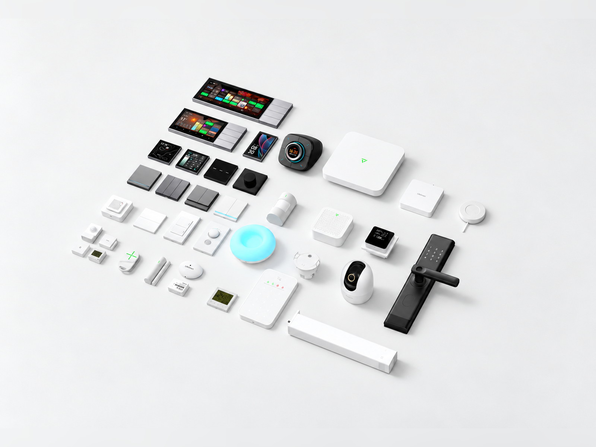
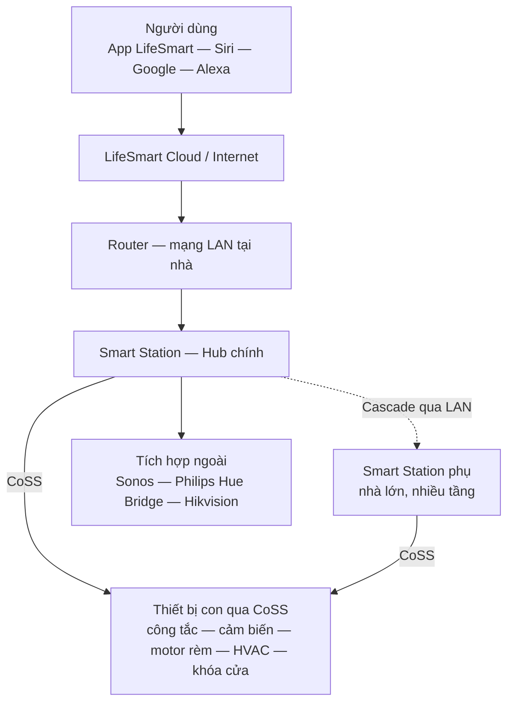

## Mục tiêu
- Hiểu giao thức CoSS là gì và tại sao nó ổn định hơn Zigbee thông thường.
- Nắm cách hệ thống LifeSmart được tổ chức và kết nối với các nền tảng khác (HomeKit, Google, Alexa).

**Sơ đồ tổ chức hệ thống LifeSmart trong một căn nhà:**

---

## 1. LifeSmart là gì?

LifeSmart là hệ thống nhà thông minh dùng giao thức không dây riêng, tập trung vào tốc độ phản hồi và sự ổn định. Thay vì dùng Zigbee hay WiFi như nhiều hãng khác, LifeSmart dùng CoSS — một giao thức hoạt động ở tần số thấp hơn, xuyên tường tốt hơn và ít bị nhiễu từ WiFi xung quanh.

Hệ thống biến thiết bị điện thông thường thành thiết bị thông minh, điều khiển qua ứng dụng điện thoại, giọng nói hoặc tự động hóa theo kịch bản.

## 2. Giao thức CoSS

CoSS (Content-Oriented Secure Service) là giao thức kết nối không dây độc quyền của LifeSmart.

| Đặc tính | Chi tiết |
|---|---|
| Tầm xa | Lên đến 200m trong không gian mở, xa hơn nhiều so với Zigbee |
| Bảo mật | Giao thức chú trọng bảo mật dữ liệu ngay từ thiết kế |
| Pin | Tiêu thụ điện rất thấp, ví dụ cảm biến chuyển động DEFED dùng pin lên đến 7 năm |
| Chống nhiễu | Tần số khác với WiFi và Zigbee (2.4 GHz) nên không bị ảnh hưởng lẫn nhau |

:::note[Tầm xa thực tế khi thi công]
Trên thực tế, tầm xa 200m là trong môi trường lý tưởng. Trong nhà có tường bê tông thường đạt khoảng 30-50m, đủ cho căn hộ và biệt thự nhỏ. Nếu không đủ thì thêm Hub phụ.
:::

## 3. Smart Station — bộ điều khiển trung tâm

Smart Station quản lý toàn bộ thiết bị con qua CoSS. Nên kết nối qua cổng mạng dây (LAN) thay vì WiFi để ổn định hơn.

Nếu nhà lớn hoặc nhiều tầng, có thể gộp nhiều Smart Station trong cùng mạng LAN (gọi là Cascade). Các thiết bị con trên Hub này vẫn được điều khiển từ Hub kia, không cần chuyển đổi trên ứng dụng. Cách gộp Station xem ở bài [B1.03 — Cấu hình App](/wiki/module-b-he-thong-thiet-bi/b1-lifesmart/03-cau-hinh-app/).

## 4. Tương thích và tích hợp

LifeSmart hỗ trợ Apple HomeKit (Siri), Google Home và Amazon Alexa.

Ngoài ra còn tích hợp được với:
- Sonos: điều khiển âm thanh đa vùng.
- Philips Hue: đồng bộ đèn thông qua Hue Bridge.
- Hikvision: xem camera trực tiếp trên ứng dụng LifeSmart và màn hình Nature 7".

---

## 5. Ưu và nhược điểm

| Ưu điểm | Nhược điểm |
|---|---|
| Phản hồi nhanh, kết nối ổn định | Hầu hết công tắc cần dây N (nguội), nhà cũ thường không có |
| Tầm xa kết nối tốt nhất trong các hệ không dây | Cần Internet để điều khiển từ xa (trong mạng nội bộ vẫn hoạt động) |
| Ứng dụng dễ dùng, tự động hóa bằng kéo thả | Chi phí đầu tư ở mức trung bình cao |

---

## 6. Lộ trình học module B1

| Bài | Nội dung | Dùng khi |
|---|---|---|
| [B1.01 — Danh sách thiết bị](/wiki/module-b-he-thong-thiet-bi/b1-lifesmart/01-danh-sach-thiet-bi/) | Toàn bộ thiết bị LifeSmart, thông số và cách chọn | Đọc bản vẽ, lên danh mục thiết bị |
| [B1.02 — Thi công lắp đặt](/wiki/module-b-he-thong-thiet-bi/b1-lifesmart/02-thi-cong-lap-dat/) | Đấu nối, lắp đặt từng dòng thiết bị tại công trình | Trước và trong khi thi công |
| [B1.03 — Cấu hình App](/wiki/module-b-he-thong-thiet-bi/b1-lifesmart/03-cau-hinh-app/) | Thêm Station, ghép thiết bị, Cascade, chia sẻ nhà | Cấu hình hệ thống sau lắp đặt |
| [B1.04 — Quy tắc đặt tên](/wiki/module-b-he-thong-thiet-bi/b1-lifesmart/04-quy-tac-dat-ten/) | Chuẩn đặt tên thiết bị, phòng, kịch bản | Trong lúc cấu hình, trước khi lập trình |
| [B1.05 — Lập trình Scene](/wiki/module-b-he-thong-thiet-bi/b1-lifesmart/05-lap-trinh-scene/) | Kịch bản, tự động hóa, kịch bản AI | Lập trình tính năng cho khách |
| [B1.06 — Xử lý sự cố](/wiki/module-b-he-thong-thiet-bi/b1-lifesmart/06-xu-ly-su-co/) | Chẩn đoán và khắc phục lỗi thường gặp | Khi hệ thống có vấn đề |

## Tài liệu tham khảo
- [Bản vẽ kỹ thuật: Sơ đồ nguyên lý](/drawings/MobiLife/MobiLife_SDNL.pdf)
- [Bản vẽ kỹ thuật: Kết nối Station](/drawings/MobiLife/MobiLife_Ket_Noi_Station.pdf)
