import ProcessSteps from '../../../../../components/ProcessSteps.astro';
import nature0 from '../../../../../assets/images/wiki/module-b/b1-lifesmart/nature_mini_doc_0.jpg';
import nature1 from '../../../../../assets/images/wiki/module-b/b1-lifesmart/nature_mini_doc_1.jpg';
import nature2 from '../../../../../assets/images/wiki/module-b/b1-lifesmart/nature_mini_doc_2.jpg';
import hvac1 from '../../../../../assets/images/wiki/module-b/b1-lifesmart/hvac-huong-dan-b1.jpg';
import hvac2 from '../../../../../assets/images/wiki/module-b/b1-lifesmart/hvac-huong-dan-b2.jpg';
import hvac3 from '../../../../../assets/images/wiki/module-b/b1-lifesmart/hvac-huong-dan-b3.jpg';
import ls212Port from '../../../../../assets/images/wiki/module-b/b1-lifesmart/ls212.jpg';
import ls212b1 from '../../../../../assets/images/wiki/module-b/b1-lifesmart/ls212-huong-dan-b1.jpg';
import ls212b2 from '../../../../../assets/images/wiki/module-b/b1-lifesmart/ls212-huong-dan-b2.jpg';

## Mục tiêu

- Đấu nối dây đúng chuẩn cho công tắc có dây N, màn hình Nature, module CUBE và công tắc SUBLIME.
- Lắp đúng Smart Station, bộ điều khiển điều hòa HVAC Gateway / LS212, cảm biến, rèm và các thiết bị phụ trợ.
- Thuộc các cảnh báo về nguồn điện, đặc biệt bộ điều khiển điều hòa trung tâm: cắm nhầm 220V vào chân tín hiệu sẽ cháy bo và không được bảo hành.
- Thi công xong là kiểm tra được ngay tại chỗ, trước khi chuyển sang cấu hình app ở bài B1.03.

## Quy trình tổng quan

Toàn bộ phần cứng của một công trình LifeSmart đi theo đúng thứ tự dưới đây. Đừng nhảy bước: lắp thiết bị con trước khi có Smart Station thì không có gì để kiểm tra sóng, cấp điện kiểm tra khi chưa đấu xong dây thì chỉ tổ mất thời gian tìm lỗi.

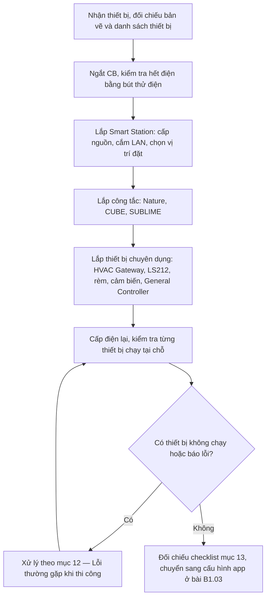

---

## 1. An toàn điện

Lắp đặt thiết bị 220V phải do thợ điện chuyên nghiệp thực hiện. Ba việc bắt buộc trước khi chạm vào bất kỳ đầu dây nào:

- Ngắt CB của nhánh sắp thi công.
- Dùng bút thử điện kiểm tra lại xem còn điện không. Đừng tin CB đã ngắt là chắc chắn hết điện, công trình cũ đấu nhầm nhánh là chuyện thường gặp.
- Bọc băng keo điện các đầu ốc vít để chống chập với đế âm kim loại. Lỗi này hay xảy ra với đế âm inox: ốc vít chạm đế là chập ngay khi cấp điện lại.

:::danger[Hai lỗi cháy thiết bị gặp nhiều nhất]
1. Cắm nhầm nguồn AC 220V vào chân tín hiệu của HVAC Gateway hoặc LS212: cháy bo ngay lập tức, hãng không bảo hành. Chi tiết ở mục 6 và 7.
2. Đấu tải nặng (bình nước nóng, bơm áp) trực tiếp qua công tắc hoặc Actuator: cháy hoặc dính tiếp điểm rơ-le. Tải nặng luôn phải qua khởi động từ (contactor) hoặc rơ-le trung gian 20A trở lên.
:::

---

## 2. Lắp bộ điều khiển trung tâm (Smart Station)

### 2.1. Cấp nguồn và kết nối mạng

- **Nguồn điện**: Cắm bộ chuyển đổi nguồn (AC Adapter) đi kèm vào Smart Station. Thiết bị không có nút nguồn vật lý, sẽ tự động khởi động ngay khi có điện.
- **Kết nối mạng**: Bắt buộc cắm cáp mạng LAN (RJ45) từ Smart Station vào Router/Switch.
  - *Lưu ý*: Với bản **DEFED Smart Station**, có hỗ trợ cấp nguồn qua cổng PoE hoặc dùng pin/SIM dự phòng.
- **Vị trí**: Đặt thiết bị ở nơi thoáng đãng, trung tâm nhà. Tránh đặt trong tủ điện kim loại kín hoặc sát các thiết bị gây nhiễu sóng mạnh (như lò vi sóng, router wifi công suất lớn) để sóng CoSS phát ổn định nhất. Smart Station đặt sai vị trí là nguyên nhân số một của lỗi "thiết bị con chập chờn" về sau, và lỗi đó rất khó truy ngược lại khi nhà đã hoàn thiện.

### 2.2. Giải pháp cho công trình quy mô lớn (Cascade)

Nếu diện tích nhà quá rộng hoặc nhiều tầng khiến một bộ trung tâm không phủ hết sóng, anh em cần dùng giải pháp **Cascade Management**:

- Mua thêm Smart Station phụ cho các khu vực sóng yếu.
- **Yêu cầu quan trọng**: Tất cả Smart Station phải được cắm vào cùng một mạng LAN nội bộ thì mới có thể liên kết và chia sẻ thiết bị với nhau.

Phần liên kết Cascade trên app làm ở bài [B1.03 — Cấu hình ứng dụng](/wiki/module-b-he-thong-thiet-bi/b1-lifesmart/03-cau-hinh-app/). Ở bước thi công này, chỉ cần đảm bảo mọi Station đều có nguồn và có LAN cùng lớp mạng.

---

## 3. Lắp công tắc và màn hình Nature

### 3.1. Sơ đồ đấu dây

- L in: dây lửa từ CB.
- N: dây trung tính (nguội).
- L1/L2/L3: dây ra tải (đèn, quạt...).

[Bản vẽ kỹ thuật: Công tắc điều khiển Đèn](/drawings/MobiLife/MobiLife_Den.pdf)

:::caution[Tải nặng không đấu trực tiếp qua công tắc]
Bình nước nóng, bơm áp TUYỆT ĐỐI không đấu trực tiếp qua công tắc. Phải dùng qua khởi động từ (contactor) hoặc rơ-le trung gian 20A trở lên.
[Bản vẽ kỹ thuật: Công tắc điều khiển Máy nước nóng](/drawings/MobiLife/MobiLife_MayNuocNong.pdf)
:::

Nếu hộp công tắc cũ không có dây N thì phải kéo thêm dây N từ tủ điện (hoặc đèn gần nhất). Công tắc LifeSmart không có dây N là không chạy, đừng cố đấu kiểu "mượn" dây tải.

### 3.2. Trình tự lắp chung

1. Chụp hình sơ đồ dây cũ trước khi tháo. Nếu cần đấu lại về trạng thái cũ thì có hình để đối chiếu.
2. Đấu dây theo sơ đồ ở mục 3.1.
3. Bọc băng keo điện đầu ốc vít (nếu đế âm kim loại).
4. Gắn thiết bị vào đế âm, siết ốc nhẹ tay. Siết mạnh quá sẽ làm hỏng đế công tắc. Không nên sử dụng máy bắt vít.

### 3.3. Chi tiết cho dòng màn hình Nature

Nature tách rời hai phần: cụm đế âm cấp tải và mặt màn hình. Ngàm liên kết giữa hai module ép khá chặt để tăng độ chắc chắn khi nhấn mặt cảm ứng, nên bước tách và ráp cần làm đúng tay, tránh vặn xoắn gây nứt mặt kính hoặc gãy chốt nhựa.

<ProcessSteps title="Trình tự lắp màn hình Nature" steps={[
  { title: 'Bước 1 — Cắt điện và kiểm tra an toàn', body: 'Dập hẳn CB cấp nguồn cục bộ của nhánh đó. Bắt buộc dùng bút thử điện xác nhận lại không còn điện rò ở dây lửa tại hộp âm tường trước khi đấu dây vào màn hình.' },
  { title: 'Bước 2 — Tách rời đế âm và cụm mặt màn hình', img: nature0.src, alt: 'Tách khớp đế và màn hình Nature', body: 'Tìm điểm tiếp nối gờ nhựa ở cạnh dưới hoặc trên, lấy que nạy dẹt bẩy nhẹ một phía ra trước. Tránh bóp sức vặn xoắn gây nứt mặt kính hoặc gãy chốt cài nhựa bên trong.' },
  { title: 'Bước 3 — Đấu cáp tải vào terminal mặt sau', img: nature1.src, alt: 'Đấu N và L cấp nguồn màn hình Nature', body: 'Lõi đồng tuốt vỏ chỉ lộ tầm 6mm, cắm chặt vào terminal. Siết chặt ốc cáp N (nguội) và L (lửa) cấp nguồn cho bo mạch. Ngõ L1, L2 nào không dùng thì để trống, tuyệt đối không đấu chập các nhánh này lại với nhau.' },
  { title: 'Bước 4 — Lên nguồn và rà soát', img: nature2.src, alt: 'Màn hình Nature khởi động sau khi cấp điện', body: 'Lùa các đoạn dây dài xếp nếp gọn gàng ôm vào thành đế âm, không để cáp đè ngay giữa. Đưa đế công tắc vào đế âm tường, vặn ốc hai bên hông siết chặt vừa tay để mặt ngàm bám sát vách tường. Ráp khít mặt màn hình vào đế công tắc, bật CB cấp điện trở lại. Màn hình sáng lên giao diện chọn ngôn ngữ là đạt. Thử bật tắt từng tải ngay tại chỗ trước khi rời vị trí.' },
]} />

Phần cài đặt trên màn hình (ngôn ngữ, Working Mode, Engineering Mode) thuộc về cấu hình, xem ở bài B1.03.

---

## 4. Lắp mô-đun công tắc CUBE (CUBE Switch Module)

Module CUBE giấu trong đế âm, biến công tắc cơ sẵn có thành công tắc thông minh. Module có loại điều khiển 1 đèn và 2 đèn. Cổng nguồn và cổng tín hiệu được cách ly rõ ràng, đấu đúng hai cụm này là xong phần khó nhất.

### 4.1. Đấu dây cơ bản (1 kênh / 2 kênh)

**Cụm dây điện lưới (N, L, L1, L2) — điện 220V:**

- Chân N / L: cắm dây nguội và lửa của điện lưới 220V vào để nuôi bảng mạch.
- Chân L1 / L2 (Live Out): ngõ ra cấp điện lên các line đèn trên trần. Tách rời đấu nối với cáp đèn tại công trình.

Lưu ý an toàn: tuốt vỏ dây điện sao cho lõi đồng lộ tối đa 5mm là vừa, cắm thẳng vào lỗ terminal. Nhô đầu đồng cao quá sẽ dễ chạm chập phóng hồ quang.

**Cụm dây tín hiệu với công tắc cơ (G, K1, K2) — chỉ là tín hiệu:**

:::caution[G, K1, K2 tuyệt đối không đấu 220V]
Chân G / K1 / K2 chỉ mang tín hiệu điện áp rất thấp (tiếp điểm khô), dùng để đọc trạng thái công tắc cơ. Đấu điện lưới vào cụm này là hỏng module.
:::

- Chân G (dây chung): đấu vào cực chung giữa của công tắc cơ.
- Chân K1 / K2: đấu vào L1 hoặc L2 trên công tắc cơ.

Khi bật công tắc, K1 sẽ chập kín mạch với chân G, vi xử lý Module nhận tín hiệu và lập tức đóng rơ-le cấp điện 220V qua cổng L1, bóng đèn sáng.

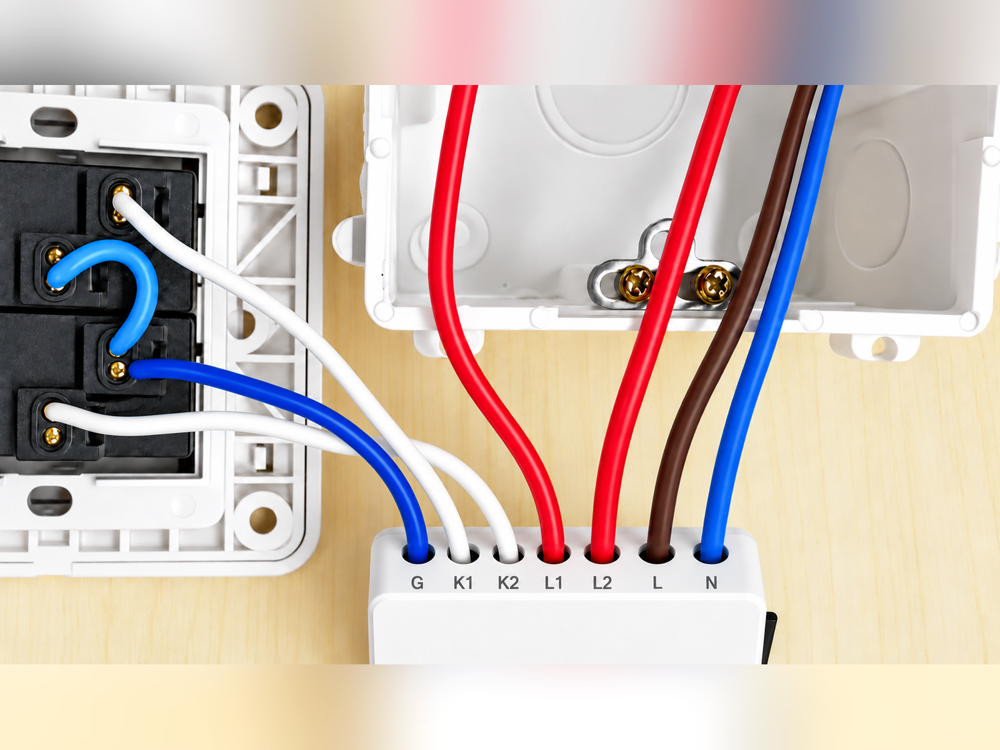

Cổng thu tín hiệu G/K1/K2 chỉ nối với công tắc cơ, cách ly hoàn toàn với cụm cáp 220V chân L, N, L1, L2.

### 4.2. Thực chiến: lắp công tắc đảo chiều tại cầu thang

Tại cầu thang, hành lang dài, phòng ngủ có cửa ra vào và đầu giường, thường có 2 công tắc cùng điều khiển 1 đèn. Với Module CUBE có 2 cách xử lý, chọn cách theo hiện trạng cáp trong tường:

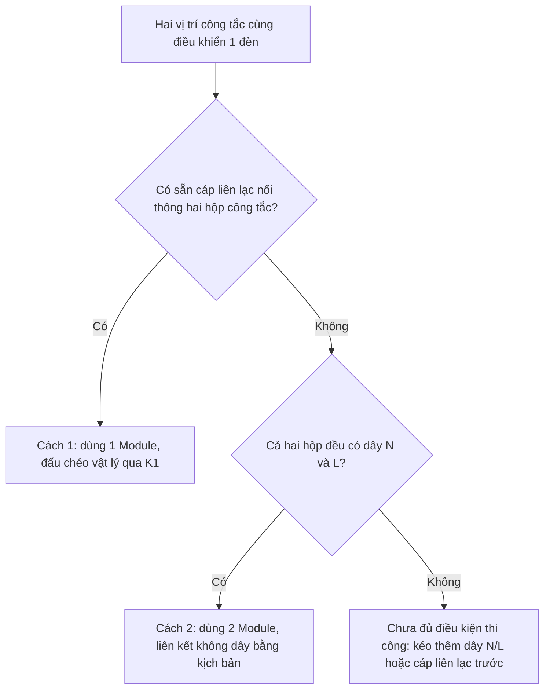

**Cách 1: Đấu chéo vật lý dùng 1 Module (nhà đã có sẵn cáp liên lạc)**

Áp dụng khi hai hộp công tắc trên dưới đã có sẵn 3 sợi dây liên lạc chạy thông với nhau trong tường. Một trong hai hộp phải có đủ dây N, L và dây kéo lên đèn.

Cách thi công: Lắp 1 Module duy nhất vào hộp đế có đủ cáp. Chân G và K1 nối vào cổng L của công tắc cơ thứ nhất và thứ hai, chân L1 và L2 của 2 công tắc đấu song song với nhau. Bấm phím ở đầu nào, tín hiệu cũng chạy qua dây liên lạc chung về cổng G-K1, Module đọc được và đảo trạng thái đèn.

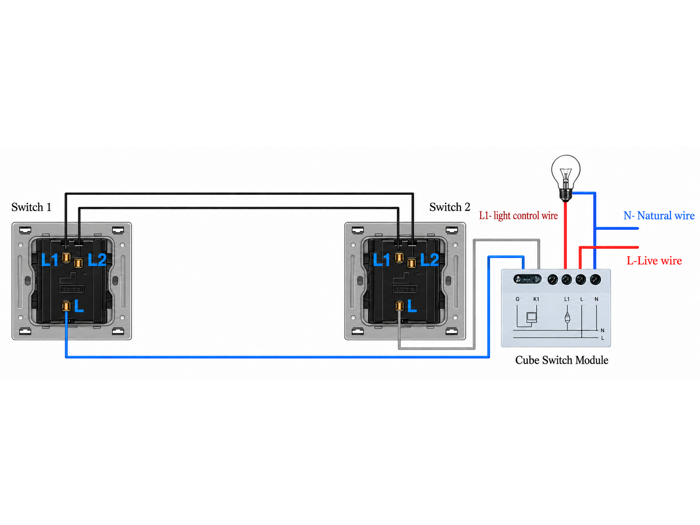

Cách đấu truyền thống: mượn 3 lõi cáp liên lạc báo gộp vào K1, chỉ cần 1 Module duy nhất.

**Cách 2: Dùng 2 Module kết nối không dây (nhà không đủ cáp liên lạc nối thông)**

Áp dụng khi hai hộp công tắc ở xa nhau, không có đường cáp liên lạc nối thông giữa hai đầu. Điều kiện là cả 2 hộp đều phải có dây N và L. Một đầu nắm cáp kéo lên đèn, đầu còn lại không cần.

Cách thi công:

- Vị trí 1 (nơi có line đèn): gắn Module số 1 vào. Đấu G / K1 cho lẩy công tắc cơ, mắc N / L nuôi sống board, và đấu L1 lên bóng đèn.
- Vị trí 2 (không có line đèn): gắn Module số 2 vào. Đấu G / K1 cho lẩy công tắc cơ, mắc N / L cấp điện nuôi board. Chân L1 bỏ trống vì hộp này không nối bóng đèn.
- Mở ứng dụng LifeSmart, tạo lệnh liên kết logic (kịch bản điều kiện kích hoạt) giữa 2 Module: khi một Module phát hiện công tắc bật, gửi lệnh không dây cho Module còn lại đảo trạng thái đèn. Phần tạo kịch bản xem bài [B1.05 — Lập trình Scene](/wiki/module-b-he-thong-thiet-bi/b1-lifesmart/05-lap-trinh-scene/).

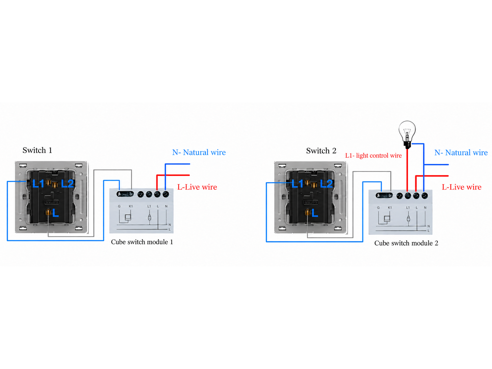

Dùng 2 Module tách biệt, liên kết bằng kịch bản không dây: giải pháp khi tường không có cáp liên lạc nối thông.

---

## 5. Lắp đặt dòng công tắc SUBLIME

### 5.1. Đấu nối Actuator (phần âm tường)

Công tắc SUBLIME tách rời giữa mặt chạm hiển thị (Panel) và hộp tiếp điểm phía sau (Actuator). Actuator đóng vai trò như một mini rơ-le chịu tải điện lưới trực tiếp (220V).

Anh em kỹ thuật thi công cần lưu ý:

- Phải kéo đủ dây **L (lửa)** và **N (nguội)** để nuôi module rơ-le và màn hình cảm ứng mặt trước.
- Phải siết thật chặt ốc tại các lỗ chia tải. Ốc lỏng, khi chạy thiết bị công suất lớn sẽ phát sinh tia lửa điện làm cháy hỏng vỏ nhựa.
- Tuyệt đối giữ sạch phần chân tiếp điểm mạ vàng. Đây là ngõ cắm duy nhất để truyền điện nhẹ một chiều và đẩy tín hiệu lên mặt cảm ứng. Bụi hoặc vôi thạch cao rơi vào sẽ gây lỗi chập chờn, liệt cảm ứng, mà lỗi này rất khó tìm vì nó đến rồi đi.

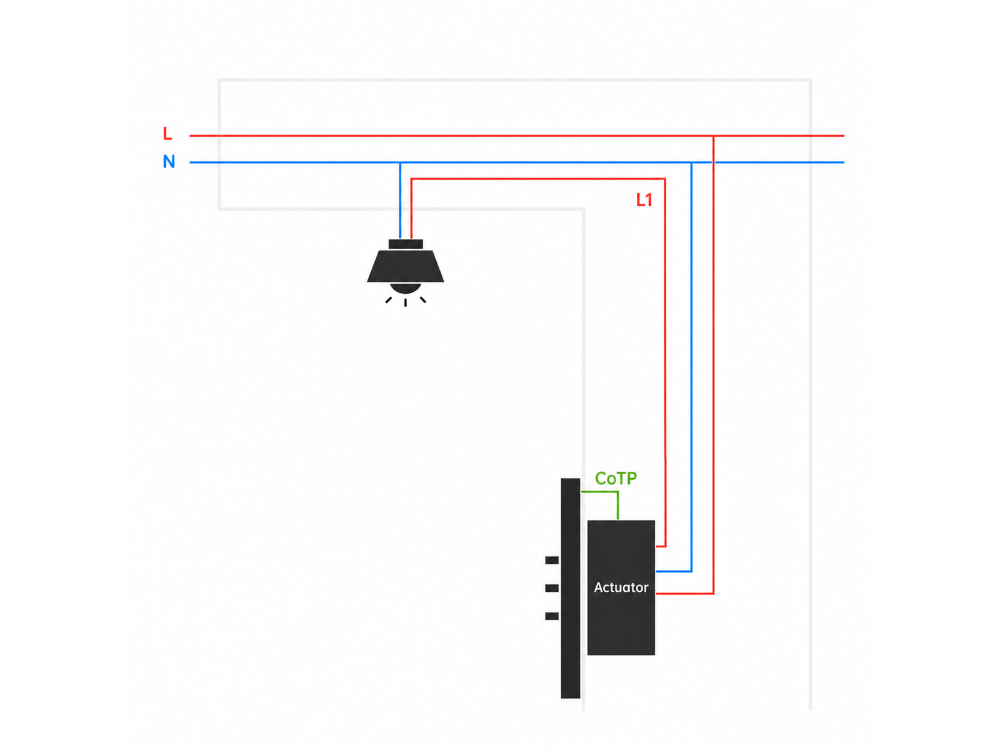

Sơ đồ đấu tải chuẩn cho Actuator SUBLIME.

### 5.2. Giới hạn chịu tải thực tế của rơ-le

Tính đúng sức tải rơ-le trước khi thi công sẽ giúp hệ thống sống thọ hơn rất nhiều:

| Loại tải | Giới hạn mỗi lộ (mỗi phím) | Ghi chú |
|---|---|---|
| Tải thuần trở (đèn sợi đốt) | Tối đa 500W | |
| Tải LED | Dưới 200W | LED rẻ tiền đánh xung dòng rất lớn khi vừa bật, gây dính tiếp điểm rơ-le. Hầu hết công trình hiện nay dùng LED nên đây là con số phải nhớ. |
| Tải nặng (bình nước nóng, bơm áp) | Không đấu trực tiếp | Bắt buộc qua khởi động từ (contactor) hoặc rơ-le trung gian 20A trở lên. |

### 5.3. Giao thức truyền thông CoTP (có dây) và luồng thi công

Khác với sóng không dây, SUBLIME dùng giao thức CoTP (Communication of Token Pass) chạy trên cáp tín hiệu 4 lõi để đồng bộ hệ thống không độ trễ.

Giao thức này có lợi là:

- Dùng dây cáp linh hoạt (cáp mạng Cat5e/Cat6 hoặc RVVSP phổ thông).
- Không yêu cầu kỹ thuật lập trình mã RS-485, cắm đúng màu cáp là hệ thống tự nhận ra nhau.

**Luồng thi công thực chiến:** Anh em có hai lựa chọn khi chạy dây cho SUBLIME:

1. **Kiểu phân tán (phổ biến nhất):** Giấu phần Actuator đóng cắt thẳng vào đế âm vuông giống hệt công tắc cơ truyền thống. Áp dụng cho nhà ống cũ cải tạo hoặc các ngôi nhà thiết kế không có tủ điện thông minh tổng. Chỉ cần đi 1 đường tín hiệu chạy vòng nối tiếp qua các mặt công tắc với nhau.
2. **Kiểu tập trung (chuyên nghiệp):** Kéo toàn bộ Actuator dồn vào tủ điện tổng. Tại vị trí vách tường trong phòng, anh em chỉ gắn duy nhất mặt Panel màn hình mỏng (không có tiếp điểm 220V đằng sau, rất an toàn). Thi công tủ trung tâm sạch sẽ nhất và kiểm tra lỗi cục bộ cũng nhanh nhất.

Chọn kiểu nào phải chốt từ lúc đi dây thô. Đổi kiểu khi đã hoàn thiện tường gần như không thể.

---

## 6. Lắp bộ điều khiển điều hòa trung tâm (HVAC Gateway)

HVAC Gateway đấu vào dàn nóng, điều khiển cả hệ điều hòa trung tâm qua một điểm. Đây là thiết bị dễ cháy nhất trong hệ LifeSmart nếu đấu sai, nên đọc kỹ cảnh báo trước khi cầm tua vít.

:::danger[Cháy nổ — cắm nhầm 220V là cháy bo ngay]
TUYỆT ĐỐI không được cắm nhầm nguồn AC 220V vào các chân tín hiệu (signal terminal). Thao tác này sẽ cháy toàn bộ linh kiện điện tử trên bo mạch ngay lập tức. Hãng nghiêm cấm việc tự ý tháo mở thiết bị để sửa chữa. Cháy do cắm nhầm nguồn không được bảo hành.

Nguồn điện yêu cầu: 12VDC. Chỉ đấu nối tín hiệu vào dàn nóng điều hòa, không đấu nối điện 220V vào Gateway.
:::

### 6.1. Kiểm tra trước khi kết nối

Phải chắc chắn hệ thống điều hòa đang chạy bình thường, không có mã lỗi báo trên panel gốc trước khi kết nối Gateway vào. Nếu điều hòa đang lỗi mà vẫn đấu vào, Gateway sẽ nhận sai trạng thái và gây khó khăn cho việc xác định nguyên nhân sau này: lúc đó không biết lỗi thuộc điều hòa hay thuộc Gateway.

### 6.2. Cổng ra tín hiệu (AIR CON Terminals) và cáp

- Cổng dữ liệu điều hòa (AIR CON Terminals) dùng để kết nối với cục nóng. Tùy hãng mà đấu dây và các cổng sẽ khác nhau, tra theo bảng bên dưới.
- Dùng cáp xoắn đôi có chống nhiễu, tiết diện tối thiểu 0.75mm².
- Không đi chung ống với đường điện xoay chiều 220V (L), khoảng cách cách ly khuyến cáo ít nhất 30cm để không rớt tín hiệu.

#### Bảng tra cứu cổng đấu nối tín hiệu (HVAC Gateway)

| Hãng (Brand) | Cổng Gateway | Cổng trên Điều hòa | Phân cực | Đấu từ dàn nóng | Địa chỉ trung tâm |
| :--- | :--- | :--- | :--- | :--- | :--- |
| **Daikin** (Multi outdoor) | F1, F2 | F1, F2 (Outside-Outside) | Không | Có | Có |
| **Daikin** (Single indoor) | F1, F2 | F1, F2 (Inside-Outside) | Không | Không | Có |
| **Hitachi** / **York-Qingdao** / **Hisense** | F1, F2 | 1, 2 | Không | Không | Không |
| **Toshiba** / **Panasonic** | F1, F2 | U1, U2 | Không | Không | Không |
| **Mitsu Electric** (Power Multi) | F1, F2 | M1, M2 (TB7/TB3/Switch box) | Không | Có/Không | Không |
| **Haier** | F1, F2 | P, Q | Không | Không | Không |
| **Gree** | H, L | G1, G2 hoặc D1, D2 | Có | Có/Không | Không |
| **MHI (Mitsubishi Heavy)** | X, Y | A1, B1 hoặc A2, B2 | Không | Không | Không |
| **TRANE** / **York-ATW** / **LG** | X, Y | A, B (hoặc CEN.) | X-A, Y-B | Có/Không | Có/Không |
| **Midea** / **Carrier** / **Bosch** | X, Y | X, Y hoặc P, Q | X-A, Y-B | Có/Không | Không |
| **Aux** | X, Y | X, Y | Có | Không | Không |
| **McQuay**-ATW / **Carrier**-ATW | X, Y | (Tùy model bàn nâng) | X-A, Y-B | Có | Không |

<ProcessSteps title="Trình tự lắp HVAC Gateway (minh họa với Daikin)" steps={[
  { title: 'Bước 1 — Đấu cáp tín hiệu', img: hvac1.src, alt: 'Đấu cáp tín hiệu cho HVAC Gateway', body: 'Xác định đúng cặp cổng theo bảng tra cứu của hãng điều hòa, đấu cáp xoắn đôi chống nhiễu 0.75mm² vào AIR CON Terminals. Kiểm tra lại lần nữa: đây là chân tín hiệu, không phải chân nguồn.' },
  { title: 'Bước 2 — Kết nối Gateway vào hệ thống điều hòa', img: hvac2.src, alt: 'Kết nối HVAC Gateway vào hệ thống điều hòa', body: 'Đấu đầu cáp còn lại vào cổng tương ứng trên dàn nóng, cấp nguồn 12VDC cho Gateway và cố định thiết bị chắc chắn, tránh vị trí đọng nước hoặc quá nóng.' },
  { title: 'Bước 3 — Đấu nối liên kết khi có nhiều dàn nóng', img: hvac3.src, alt: 'Đấu nối liên kết nhiều dàn nóng', body: 'Hệ thống có nhiều dàn nóng thì đấu liên kết theo sơ đồ của hãng, kiểm tra địa chỉ trung tâm nếu hãng yêu cầu. Đấu xong mới cấp điện và kiểm tra Gateway nhận đủ số dàn lạnh.' },
]} />

---

## 7. Lắp bộ điều khiển điều hòa PRO (LS212)

LS212 kết nối trực tiếp vào dàn lạnh, giao tiếp 1-1 với từng dàn lạnh riêng biệt. Mỗi dàn lạnh một bộ LS212, khác với HVAC Gateway đấu tập trung ở dàn nóng.

:::danger[Cháy nổ và hư mạch giao tiếp]
- TUYỆT ĐỐI không được cắm nhầm nguồn AC 220V vào các chân tín hiệu. Cháy toàn bộ linh kiện trên bo mạch ngay lập tức, không được bảo hành, hãng cấm tự ý tháo mở sửa chữa.
- Bắt buộc ngắt điện cả hệ thống điều hòa lẫn LS212 trước khi đấu nối bất kỳ dây nào. Đấu nối khi đang có điện rất dễ phá hỏng mạch giao tiếp bên trong LS212, vì dòng tín hiệu trên bus điều hòa rất nhạy.
:::

### 7.1. Kiểm tra trước khi kết nối

Phải chắc chắn hệ thống điều hòa đang chạy bình thường, không có mã lỗi báo trên panel gốc trước khi kết nối LS212 vào. Điều hòa đang lỗi mà vẫn đấu vào, LS212 sẽ nhận sai trạng thái và sau này không phân định được lỗi do đâu.

### 7.2. Nguồn điện

Thiết bị có thể sử dụng nguồn 12VDC hoặc nguồn trực tiếp từ board mạch dàn lạnh (tham khảo thêm tài liệu hướng dẫn của hãng cho từng model dàn lạnh).

### 7.3. Đấu cáp tín hiệu vào dàn lạnh

- Cáp tín hiệu đấu từ cổng AIR CON Interface trên LS212 vào cổng tín hiệu trên board mạch dàn lạnh.
- **Nếu đấu sai cực (đảo thứ tự dây)**: đèn RUN sẽ nháy nhanh mãi không dừng, thiết bị không tìm thấy điều hòa. Lúc này chỉ cần đảo lại 2 đầu dây tín hiệu là xong. Đây là dấu hiệu nhận biết nhanh nhất khi LS212 không kết nối được, kiểm tra cực dây trước khi nghi ngờ hỏng thiết bị.
- Không đi chung cáp tín hiệu với cáp nguồn điện lưới.

<ProcessSteps title="Nhận diện phần cứng và trình tự lắp LS212" steps={[
  { title: 'Bước 1 — Nhận diện các cổng trên LS212', img: ls212Port.src, alt: 'Sơ đồ cổng kết nối LS212', body: 'Trên thân LS212: (1) Đèn STA/RUN, (2) Nút SET, (3) Các cổng AIR CON, (4) Cổng H1/H2, (5) Cổng PANEL A2/B2, (6) Ngõ ra nguồn. Xác định đúng cổng của hãng điều hòa đang lắp theo bảng tra cứu bên dưới trước khi đấu.' },
  { title: 'Bước 2 — Chuẩn bị và đấu nối cáp tín hiệu', img: ls212b1.src, alt: 'Đấu nối cáp tín hiệu cho LS212', body: 'Ngắt điện toàn bộ hệ thống, đấu cáp tín hiệu từ LS212 vào board dàn lạnh đúng cực theo bảng tra cứu. Với hãng có phân cực, đấu sai là đèn RUN nháy nhanh liên tục.' },
  { title: 'Bước 3 — Hoàn thiện và cố định thiết bị', img: ls212b2.src, alt: 'Hoàn thiện lắp đặt LS212', body: 'Cố định LS212 vào vị trí trong hoặc cạnh dàn lạnh, gọn cáp, cấp điện lại và kiểm tra đèn trạng thái: RUN nháy nhanh không dừng là sai cực, xử lý theo mục 7.3.' },
]} />

#### Bảng tra cứu cổng đấu nối tín hiệu (LS212)

| Hãng (Brand) | Cổng LifeSmart | Cổng trên dàn lạnh | Phân cực | Dùng song song remote gốc |
| :--- | :--- | :--- | :--- | :--- |
| **Daikin** VRV | P1, P2 | P1, P2 | Không | Có |
| **Hitachi** / **Hisense** / **York** (VRV) | P1, P2 | A, B | Không | Có |
| **Hitachi** (US) | A1, B1, D-, D+ | CN2 | Có | Không |
| **Toshiba** / **MHI** (VRV) | X, Y / P1, P2 | A, B / X, Y | Không | Có |
| **Panasonic** VRV | X, Y | CN041 (outside 2pin) | Không | Có |
| **MHI** (loại 3 dây) | A1&B1 song song, X, Y | CNB | Không | Có |
| **Midea** (Coolfree / Trung tâm) | A1, B1, D-, D+ | CN40 / CN20 | Có | Không / Có |
| **Gree** VRV | P1, P2 | H1, H2 | Không | Có |
| **Gree** (Giấu trần 2-4 dây) | H1, H2 / A1, B1, D-, D+ | COM_MANUAL / CN5-CN6 | Có | Có / Không |
| **Haier** (VRV / Giấu trần) | A, B, C / A1&B1 song song | CN22 / CONTROLLER / CN4 | Có | Không / Có |
| **Daikin** MX | A1, B1, D-, D+ | S21 | Có | Không |
| **Mitsu Electric** (Power Multi) | A1, B1, D-, D+ | CN105 | Có | Có |
| **Hisense** (Giấu trần N+) | A1, B1, D-, D+ | WIFI | Có | Có |

---

## 8. Lắp cảm biến

### 8.1. Cảm biến cửa (Door Sensor)

- Khoảng cách giữa thân và nam châm không quá 15mm. Khe hở lớn hơn là cảm biến không nhận được tín hiệu đóng/mở.
- Tránh gắn trên cửa kim loại vì kim loại làm lệch từ trường. Nếu bắt buộc gắn cửa sắt, dùng thêm miếng đệm nhựa cách ly.

### 8.2. Cảm biến chuyển động Pro (Motion Sensor Pro)

- Gắn ở độ cao 2.2 – 2.5m để đạt phạm vi quét tốt nhất (8 mét, góc 120°).
- Không hướng thẳng vào nguồn nhiệt (bếp, cửa gió điều hòa, ánh nắng trực tiếp) vì sẽ bị kích hoạt giả.
- Sử dụng pin CR123A.

### 8.3. Cảm biến tràn nước (Water Leak)

- Đầu dò đặt chạm mặt sàn, ở vị trí thấp nhất dễ đọng nước như gầm bồn rửa, cạnh máy giặt.
- Thân gắn lên tường cao để tránh ngập mạch. Chỉ dùng trong nhà.

### 8.4. Cảm biến hiện diện Human Presence (MSA201 Z)

Cảm biến hiện diện âm trần, dùng sóng microwave, nên điều kiện lắp đặt khắt khe hơn hẳn các cảm biến khác:

- **Khoét lỗ**: đường kính **55mm**.
- **Đấu nguồn**: nguồn xoay chiều AC 110-240V trực tiếp (chân L-N).
- **Vị trí lắp đặt**:
  - Phải gắn cố định chắc chắn trên trần. Nếu cảm biến bị rung lắc (trần thạch cao lỏng hoặc gần máy móc rung), nó sẽ nhận diện nhầm thành có người.
  - Tránh xa các vật thể kim loại lớn, tường bê tông dày hoặc dầm (beam) vì chúng cản bước sóng microwave.
  - Tránh lắp gần cửa sổ có rèm vải mỏng: rèm phất phơ do gió sẽ bị nhận diện là chuyển động.
  - Tránh lắp gần cục nóng điều hòa, quạt thông gió hoặc các thiết bị không dây (router wifi) trong bán kính 1.5m để tránh nhiễu tín hiệu.
  - Khoảng cách tối thiểu giữa 2 cảm biến hiện diện là 2m để tránh gây nhiễu lẫn nhau.

---

## 9. Lắp bộ General Controller

General Controller là cầu nối đưa thiết bị thường (báo khói, cổng, cửa cuốn) vào hệ LifeSmart qua tiếp điểm khô.

### 9.1. Đưa thiết bị báo khói thường vào hệ thống thông minh

Cắm cảm biến khói loại công nghiệp chạy nguồn 12V một chiều:

- Đấu chân NC từ cảm biến khói vào ngõ K1. Nhớ nối thêm 1 chân GND về ngõ COM để khép kín mạch báo động.
- Khi cảm biến khói nhảy cắt tiếp điểm khô, ứng dụng sẽ bật cảnh báo thông qua kịch bản đã cài sẵn. Cách này đơn giản nhưng hiệu quả: biến hệ báo cháy công nghiệp thường thành hệ báo cháy thông minh gửi thông báo về điện thoại.

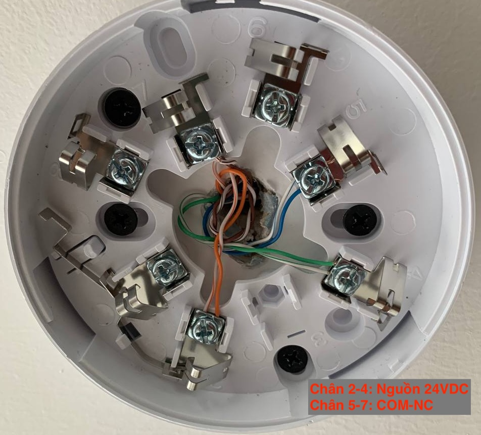

Hướng dẫn đấu nối tiếp điểm bộ báo khói về General Controller.

### 9.2. Điều khiển cổng tự động (tiếp điểm khô)

- Xác định tiếp điểm đóng mở cổng (thường là NO), đấu về cổng CH và chân COM+.
- Hầu hết các board mạch cổng tự động đều có ngõ vào cho nút nhấn tay (Push button), anh em đấu song song vào đó.
- Nếu cổng hoặc cửa cuốn cần dùng nhiều kênh thì phải đấu qua rơ-le trung gian, sử dụng các chân CH1, CH2, CH3 kết hợp với COM+ để điều khiển rơ-le trung gian đó.

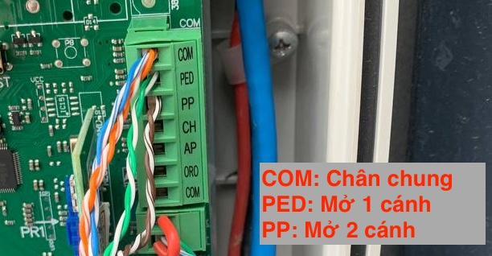

Hướng dẫn đấu nối tiếp điểm điều khiển cho motor cổng tự động.

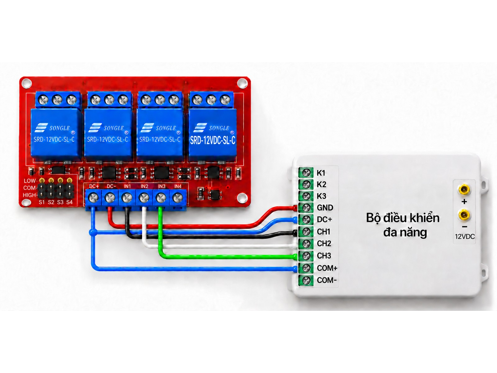

General Controller điều khiển thông qua rơ-le trung gian để đảm bảo an toàn và chịu tải.

### 9.3. Điều khiển cửa cuốn

Tùy vào loại board mạch motor, sơ đồ tiếp điểm điều khiển có thể khác nhau. Dưới đây là các dạng đấu nối thông dụng:

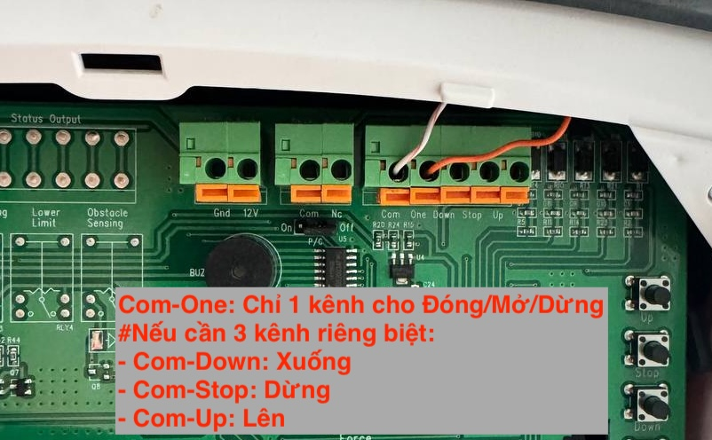
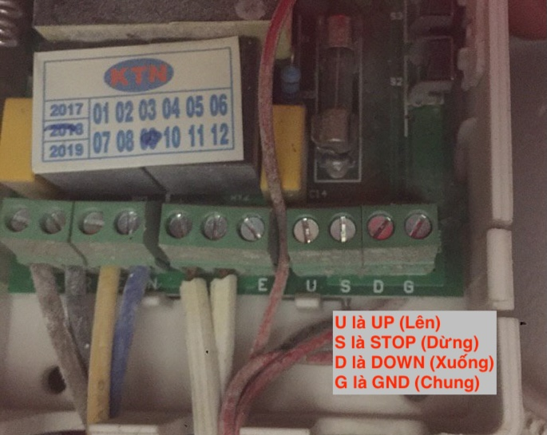
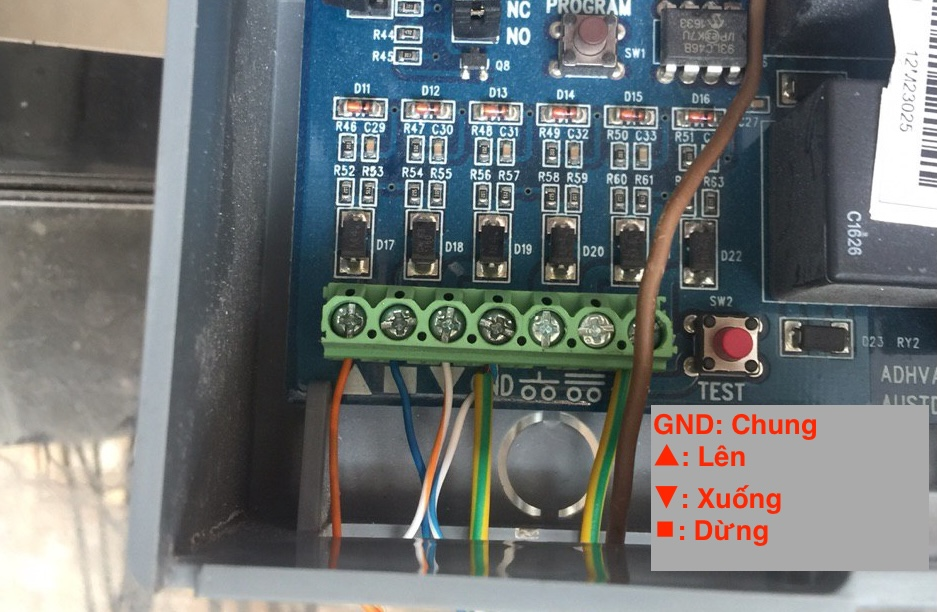
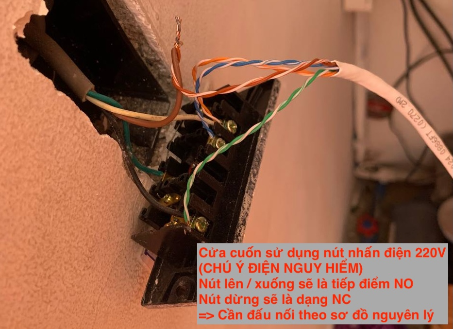

Tổng hợp các sơ đồ đấu nối tiếp điểm điều khiển cho các dòng motor cửa cuốn phổ biến trên thị trường.

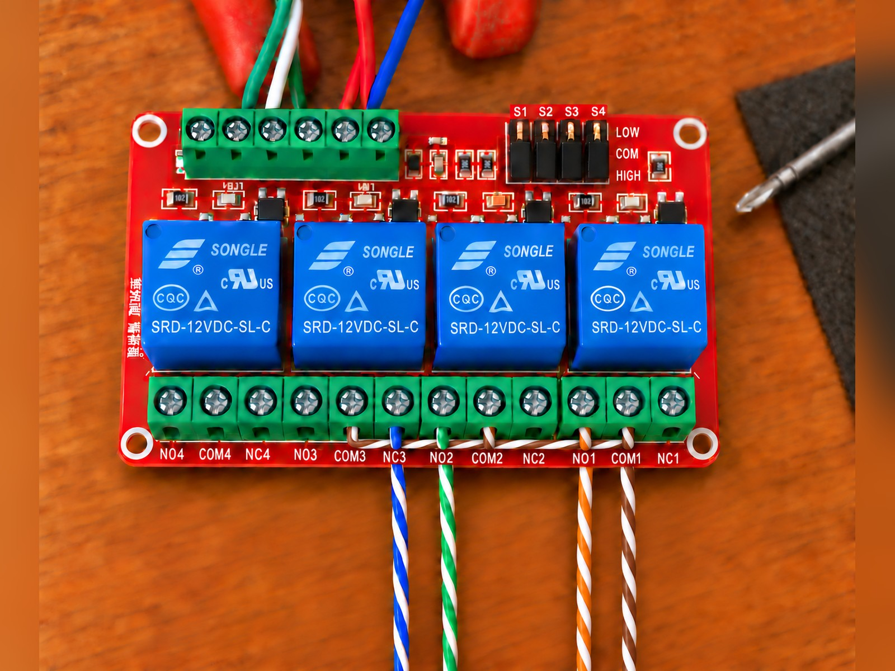

Sơ đồ đấu nối điều khiển cửa cuốn loại AC 220V qua bộ General Controller.

- Đối với cửa cuốn 220V, chân Dừng (Stop) thường là dạng NC, chân Lên (Up) và Xuống (Down) là dạng NO. Nhớ kỹ điểm này, đấu nhầm NC/NO là cửa chạy không dừng hoặc không chạy.

### 9.4. Bản vẽ kỹ thuật (sơ đồ đấu nối)

- [Cửa cổng và Beam](/drawings/MobiLife/MobiLife_CuaCong_Beam.pdf)
- [Cửa cuốn](/drawings/MobiLife/MobiLife_CuaCuon.pdf)

---

## 10. Lắp motor rèm

### 10.1. Lắp motor rèm QuickLink

**Chuẩn bị hộc rèm:** Trước khi thi công, phải kiểm tra kích thước hộc rèm trên trần:

- Rèm 1 lớp: hộc rèm tối thiểu 15cm chiều sâu.
- Rèm 2 lớp (rèm vải + rèm voan): hộc rèm tối thiểu 25cm chiều sâu để đủ chỗ cho 2 bộ ray + motor song song.
- Đảm bảo có ổ cắm điện hoặc nguồn dây cứng AC 220V sẵn bên trong hộc rèm. Nguồn đầu vào của motor QuickLink là AC 100–240V, 50/60Hz. Hộc rèm thiếu ổ cắm là lỗi của khâu thô, phát hiện ở bước này thì còn xử lý được, để đến lúc treo rèm mới phát hiện là rất phiền.

**Lắp ráp thanh ray QuickLink:** Hệ thống ray QuickLink là dạng module tự ghép, không cần đặt xưởng cắt ray riêng:

1. Đo chiều dài cửa sổ hoặc vách kính cần lắp rèm.
2. Chọn các đoạn ray phù hợp (1m, 0.5m, 0.2m, 0.1m) và thanh nối (connector) để ghép thành đúng chiều dài mong muốn.
3. Lắp các đoạn ray vào nhau bằng cách trượt thanh nối vào rãnh nhôm, nghe tiếng "click" là đã khớp.
4. Lắp giá treo ray lên trần hoặc vào hộc rèm bằng vít nở. Khoảng cách giữa các giá treo khoảng 50–60cm.
5. Treo ray đã ghép xong lên giá treo.

**Lắp động cơ và kết nối nguồn:**

1. Gắn motor QuickLink vào đầu ray (phía có ổ cắm điện).
2. Cắm nguồn AC cho motor. Sau khi cấp điện, motor sẽ sẵn sàng ghép nối với hệ thống LifeSmart.
3. Lắp các móc treo rèm vào rãnh ray, sau đó treo rèm lên.

**Video hướng dẫn lắp đặt** (lưu ở Drive, không nhúng file vào repo):

- [Video hướng dẫn lắp ráp ray QuickLink 1](https://drive.google.com/file/d/1JLGIpZ6Uo-SaWTvAewWFdrA0LqwklRS_/view?usp=sharing)
- [Video hướng dẫn lắp ráp ray QuickLink 2](https://drive.google.com/file/d/1SUdmV5C4_-uyes6aIGcPJlekM9YoUmr4/view?usp=sharing)

### 10.2. Lắp bộ điều khiển rèm MINS

Bộ điều khiển rèm MINS là module rời, không gắn liền vào ray, dùng để điều khiển động cơ rèm truyền thống.

**Vị trí lắp đặt:** Do kích thước nhỏ gọn, MINS thường được lắp tại:

- **Trên trần thạch cao**: đặt sát động cơ rèm để thuận tiện đấu nối dây tín hiệu.
- **Sau công tắc**: giấu trong đế âm tường nếu dùng công tắc cơ để kích hoạt lệnh tay.

**Đấu nối phần cứng:**

- **Dây tín hiệu**: Đấu nối các chân điều khiển từ MINS vào các cổng lệnh (Mở/Đóng/Dừng) trên động cơ rèm truyền thống theo sơ đồ đi kèm.
- **Lưu ý**: Đảm bảo các mối nối được bọc cách điện an toàn, đặc biệt khi lắp trên trần thạch cao.

---

## 11. Các thiết bị còn lại

### 11.1. Lắp SPOT (điều khiển hồng ngoại)

SPOT đặt trong tầm nhìn thẳng với thiết bị cần điều khiển (TV, máy lạnh). Nếu bị vật cản che thì hồng ngoại không truyền tới được. Trước khi cố định, đứng ở vị trí đặt SPOT và nhìn về phía thiết bị: mắt nhìn không thấy thì SPOT cũng không "thấy".

### 11.2. Lắp bộ điều khiển Dimmer 0-10V (LS180)

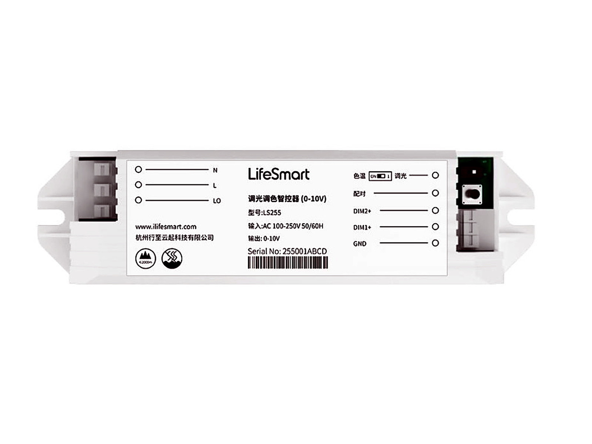

Bộ điều khiển Dimmer 0-10V LS180.

Thiết bị LS180 có 2 cụm dây chính cần lưu ý:

- **Cụm cấp nguồn (N, L)**:
  - **N**: Dây trung tính (nguội).
  - **L**: Dây lửa.
- **Cụm tín hiệu dimming (+ , -)**:
  - **+**: Nối vào cực dương (+) của bộ Driver điều khiển đèn.
  - **-**: Nối vào cực âm (-) của bộ Driver điều khiển đèn.

Lưu ý kỹ thuật quan trọng:

- **Kiểm tra chuẩn Dimming**: LS180 chỉ tương thích với hệ thống đèn hỗ trợ chuẩn dimming 0-10V hoặc 1-10V.
- **Giới hạn khoảng cách**: Độ dài dây tín hiệu từ LS180 đến đèn không nên vượt quá **20 mét** để tránh sụt áp gây sai lệch độ sáng.
- **Khả năng tải**: Một bộ LS180 có thể điều khiển song song nhiều đèn (khoảng 50 đèn LED), miễn là tổng dòng điều khiển không quá **100mA**.
- **An toàn**: Luôn ngắt điện hoàn toàn trước khi đấu nối. Kiểm tra kỹ cực tính (+) và (-) của dây tín hiệu để tránh hỏng Driver đèn.
- [Bản vẽ kỹ thuật: Dimmer 0-10V & Color](/drawings/MobiLife/MobiLife_Dimmer_0-10V_Color.pdf)

### 11.3. Lắp bộ điều khiển Dimmer DALI

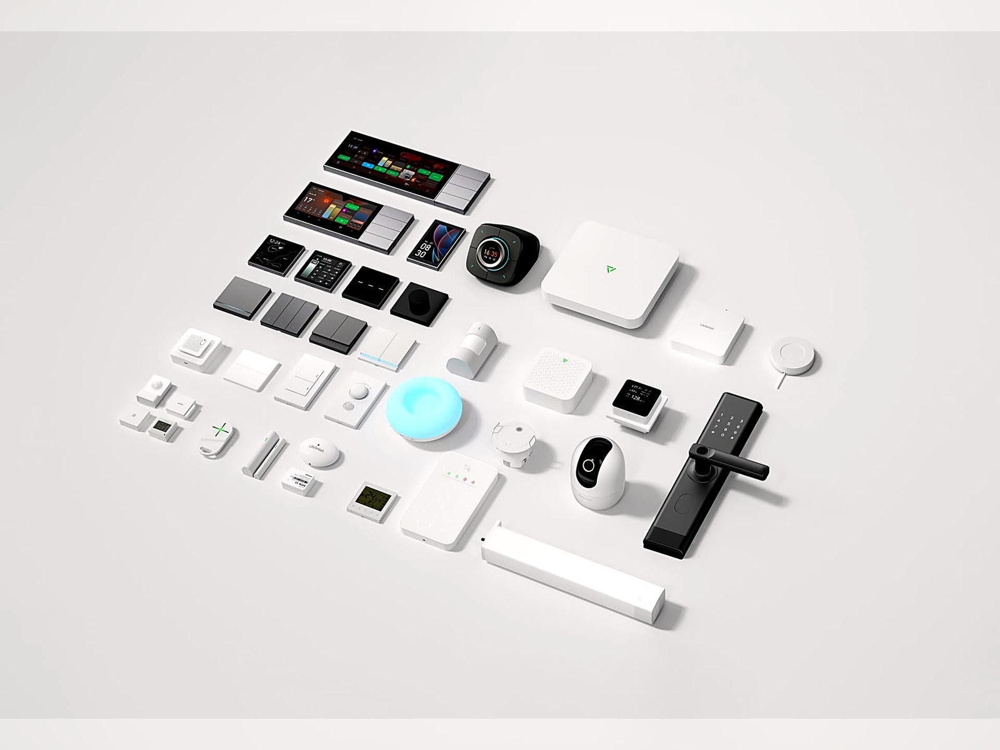

Bộ điều khiển DALI Controller của LifeSmart.

Ý nghĩa các cổng kết nối:

- **Cổng DALI (DALI control connection line)**: Kết nối trực tiếp vào đường bus của hệ thống DALI.
- **Cổng cấp nguồn (Power supply interface)**: Cấp nguồn DC từ 12V đến 24V.
- **Công tắc gạt (Dip switch)**:
  - Gạt sang trái (phía cổng nguồn DC): Sử dụng nguồn từ Adapter DC 12-24V.
  - Gạt sang phải (phía cổng DALI): Sử dụng nguồn trực tiếp từ đường bus DALI (nếu bus có tích hợp nguồn).
- **Nút ghép nối (Pairing button)**: Dùng để đăng ký thiết bị vào Smart Station.

Sơ đồ và cấu trúc mạng:

- **Topology**: Hỗ trợ nối tiếp (series), hình sao (star) hoặc hỗn hợp. **Tuyệt đối không đấu nối dạng vòng (ring)** vì sẽ gây lỗi hệ thống truyền thông.
- **Khoảng cách**: Tổng chiều dài cáp DALI không vượt quá **300 mét**.
- [Bản vẽ kỹ thuật: Dimmer Dali](/drawings/MobiLife/MobiLife_Dimmer_Dali.pdf)

### 11.4. Tích hợp khóa thông minh Yale

Việc tích hợp khóa Yale thông qua module kết nối (SL_LK_YL) yêu cầu thao tác trực tiếp trên thân khóa:

1. **Lắp bộ mặt khóa và kết nối module**: Kỹ thuật viên lắp đặt bộ mặt khóa Yale lên cửa theo đúng quy trình của hãng khóa. Module LifeSmart dành cho khóa Yale cắm trực tiếp vào cổng module trên bo mạch phía sau của khóa.
2. **Cấu hình sau khi cắm module**: Thực hiện lệnh ghép nối (Pairing) trên khóa để khóa nhận diện module và truyền tín hiệu về Smart Station. Kiểm tra tính năng mở khóa từ xa trên App. Nếu không mở được, kiểm tra lại tham số `enable_remote_unlock` trong cài đặt.

---

## 12. Lỗi thường gặp khi thi công

Tổng hợp từ chính các lưu ý rải rác trong bài này. Cấp điện kiểm tra mà gặp hiện tượng bên trái, tra nguyên nhân ở cột giữa trước khi tháo thiết bị ra kiểm tra lan man.

| Hiện tượng | Nguyên nhân thường gặp | Cách xử lý |
|---|---|---|
| Chập điện, nhảy CB ngay khi cấp điện lại | Ốc vít chạm đế âm inox, hoặc đầu đồng tuốt quá dài chạm chập | Bọc băng keo điện đầu ốc, tuốt lõi đồng tối đa 5-6mm |
| HVAC Gateway / LS212 chết hẳn sau khi đấu | Cắm nhầm 220V vào chân tín hiệu | Không cứu được, thay thiết bị. Phòng ngừa: kiểm tra chân tín hiệu và nguồn 12VDC trước khi cấp điện |
| LS212 đèn RUN nháy nhanh mãi không dừng | Đấu sai cực 2 dây tín hiệu | Đảo lại 2 đầu dây tín hiệu |
| Gateway không nhận điều hòa hoặc nhận sai trạng thái | Điều hòa đã có lỗi từ trước khi đấu, hoặc sai cặp cổng theo hãng | Kiểm tra panel gốc hết lỗi trước; tra lại bảng cổng của đúng hãng và model |
| Đèn LED bị dính, tắt không tắt hẳn hoặc rơ-le kêu | Tải LED vượt 200W/lộ, xung khởi động làm dính tiếp điểm | Hạ tải dưới 200W/lộ hoặc đấu qua rơ-le trung gian |
| Công tắc không chạy dù đã đấu đủ dây | Hộp công tắc không có dây N thật, hoặc đấu "mượn" dây tải | Kéo dây N từ tủ điện hoặc đèn gần nhất |
| SUBLIME liệt cảm ứng, chập chờn | Bụi, vôi thạch cao rơi vào chân tiếp điểm mạ vàng của Actuator | Vệ sinh chân tiếp điểm, che chắn Actuator khi thi công thạch cao |
| CUBE không phản hồi khi bấm công tắc cơ | Đấu nhầm cụm tín hiệu G/K1/K2, hoặc có điện áp lạ vào cụm tín hiệu | Kiểm tra lại: G là dây chung, K1/K2 vào cực của công tắc cơ; cụm này tuyệt đối không có 220V |
| Cảm biến cửa không báo đóng/mở | Khe hở thân và nam châm quá 15mm, hoặc gắn trên cửa kim loại gây lệch từ trường | Thu hẹp khe hở; thêm đệm nhựa cách ly khi gắn cửa sắt |
| Cảm biến chuyển động báo giả | Hướng thẳng vào bếp, cửa gió điều hòa hoặc nắng trực tiếp | Đổi hướng hoặc vị trí, giữ độ cao 2.2 – 2.5m |
| Cảm biến hiện diện báo có người khi phòng trống | Trần rung lắc, gần rèm mỏng bay, hoặc 2 cảm biến cách nhau dưới 2m | Gia cố trần, đổi vị trí xa rèm và xa nguồn rung, giữ khoảng cách tối thiểu 2m giữa 2 cảm biến |
| Đèn dim bị sai độ sáng, nhấp nháy | Dây tín hiệu 0-10V dài quá 20m gây sụt áp, hoặc đấu sai cực +/- | Rút ngắn đường dây, kiểm tra lại cực tính |
| Hệ DALI lỗi truyền thông toàn tuyến | Đấu bus dạng vòng (ring) hoặc tổng cáp quá 300m | Đấu lại dạng nối tiếp, sao hoặc hỗn hợp; rút ngắn tổng chiều dài cáp |
| SPOT không điều khiển được TV, máy lạnh | SPOT bị vật cản che, không có tầm nhìn thẳng tới thiết bị | Dời SPOT tới vị trí nhìn thẳng được thiết bị |
| Điều hòa nhận lệnh chập chờn | Cáp tín hiệu đi chung ống với dây 220V | Tách ống, giữ khoảng cách cách ly ít nhất 30cm |

---

## 13. Checklist trước khi rời công trình

Đối chiếu thêm [Checklist thi công LifeSmart](/wiki/bieu-mau-templates/checklist-thi-cong-lifesmart/) của Module biểu mẫu. Phần cứng đạt hết các mục dưới đây mới chuyển sang bài [B1.03 — Cấu hình ứng dụng](/wiki/module-b-he-thong-thiet-bi/b1-lifesmart/03-cau-hinh-app/):

- [ ] Smart Station có nguồn, có LAN, đặt vị trí thoáng và trung tâm; công trình nhiều Station thì mọi Station cùng một mạng LAN.
- [ ] Mọi công tắc, Nature, CUBE, SUBLIME đã cấp điện thử và điều khiển tải tại chỗ được.
- [ ] Tải nặng (bình nước nóng, bơm) đều qua contactor hoặc rơ-le trung gian, không đấu trực tiếp.
- [ ] HVAC Gateway / LS212: đèn trạng thái bình thường, điều hòa đáp ứng lệnh, không còn đèn RUN nháy nhanh.
- [ ] Cảm biến cửa, chuyển động, tràn nước, hiện diện đã test kích hoạt thực tế từng con.
- [ ] Rèm chạy hết hành trình mở và đóng, không kẹt ray.
- [ ] General Controller: báo khói, cổng, cửa cuốn đều đáp ứng lệnh test.
- [ ] Toàn bộ đế âm đã bọc cách điện đầu ốc, nắp che và mặt thiết bị ráp khít, không hở dây.

---

## Tài liệu tham khảo

- [LifeSmart Brochure 250929.pdf](https://drive.google.com/file/d/1fTBlvwOsanYKhR_P5AMORJnfAf_2o4uE/view?usp=drive_link)
- [Thư mục tài liệu tổng hợp LifeSmart (Drive)](https://drive.google.com/drive/folders/1RGZRgWJHFBUisvcJDJZeW6HBTIsZKWBy)
- [Thư mục tài liệu kỹ thuật LifeSmart (Drive)](https://drive.google.com/drive/folders/1B_znIzettzmx4HUYxsCR26Z_aZ9bF1Lm)
