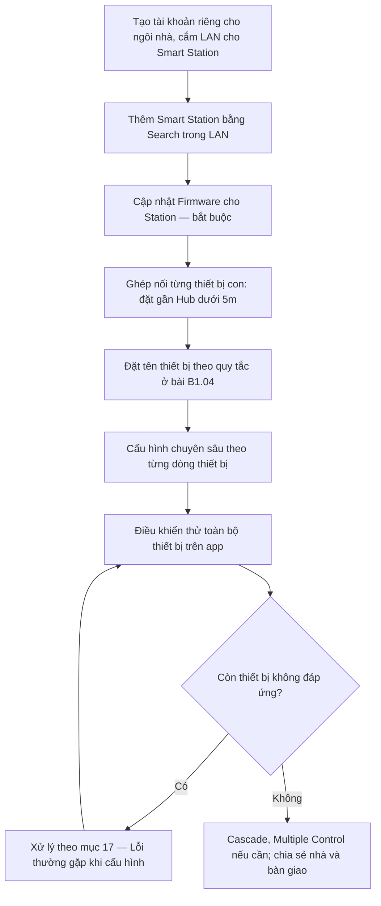
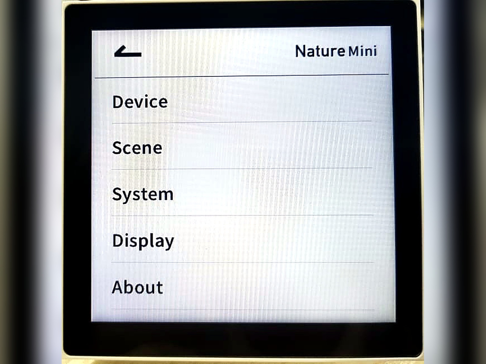
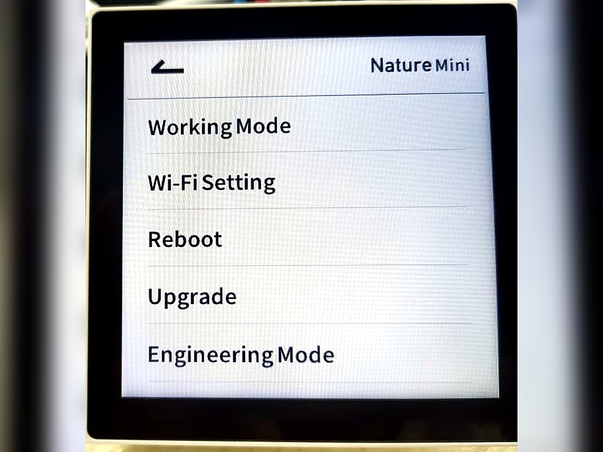
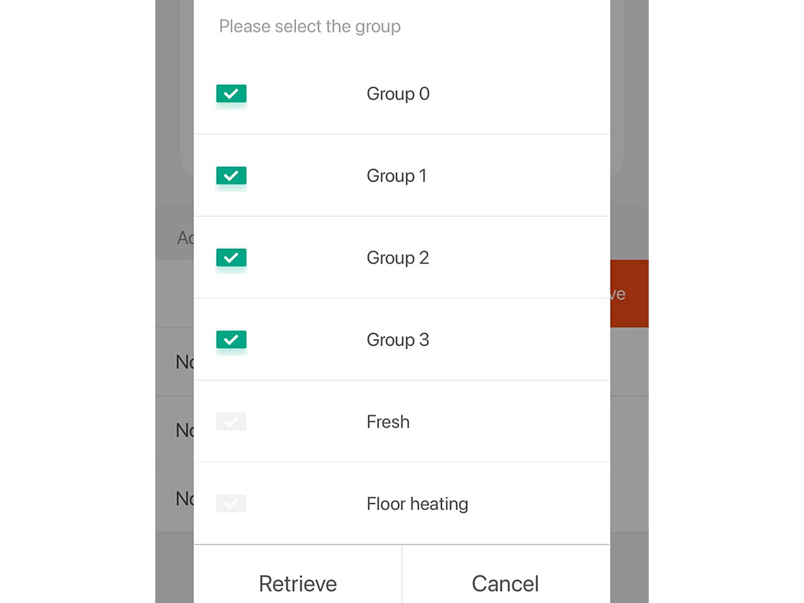
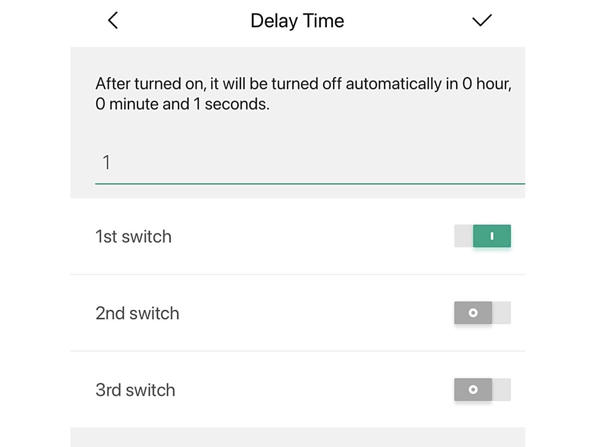

import ProcessSteps from '../../../../../components/ProcessSteps.astro';
import HVACDiagram from '../../../../../components/HVACDiagram.astro';
import addStation1 from '../../../../../assets/images/wiki/module-b/b1-lifesmart/add-station-1.jpeg';
import addStation2 from '../../../../../assets/images/wiki/module-b/b1-lifesmart/add-station-2.jpeg';
import addStation3 from '../../../../../assets/images/wiki/module-b/b1-lifesmart/add-station-3.jpeg';
import addStation4 from '../../../../../assets/images/wiki/module-b/b1-lifesmart/add-station-4.jpeg';
import updateStation1 from '../../../../../assets/images/wiki/module-b/b1-lifesmart/update-station-1.jpeg';
import updateStation2 from '../../../../../assets/images/wiki/module-b/b1-lifesmart/update-station-2.jpeg';
import updateStation3 from '../../../../../assets/images/wiki/module-b/b1-lifesmart/update-station-3.jpeg';
import updateStation4 from '../../../../../assets/images/wiki/module-b/b1-lifesmart/update-station-4.jpeg';
import natureDoc3 from '../../../../../assets/images/wiki/module-b/b1-lifesmart/nature_mini_doc_3.jpg';
import natureDoc4 from '../../../../../assets/images/wiki/module-b/b1-lifesmart/nature_mini_doc_4.jpg';
import cascade1 from '../../../../../assets/images/wiki/module-b/b1-lifesmart/station-cascade-1.jpeg';
import cascade2 from '../../../../../assets/images/wiki/module-b/b1-lifesmart/station-cascade-2.jpeg';
import cascade3 from '../../../../../assets/images/wiki/module-b/b1-lifesmart/station-cascade-3.jpeg';
import cascade4 from '../../../../../assets/images/wiki/module-b/b1-lifesmart/station-cascade-4.jpeg';
import multipleControl1 from '../../../../../assets/images/wiki/module-b/b1-lifesmart/multiple-control-1.jpeg';
import multipleControl2 from '../../../../../assets/images/wiki/module-b/b1-lifesmart/multiple-control-2.jpeg';
import multipleControl3 from '../../../../../assets/images/wiki/module-b/b1-lifesmart/multiple-control-3.jpeg';
import family1 from '../../../../../assets/images/wiki/module-b/b1-lifesmart/family-management-1.jpeg';
import family2 from '../../../../../assets/images/wiki/module-b/b1-lifesmart/family-management-2.jpeg';
import stationPrep from '../../../../../assets/images/wiki/module-b/b1-lifesmart/add-station-step-1-prep.jpg';
import familyMenu from '../../../../../assets/images/wiki/module-b/b1-lifesmart/family-step-1-menu.jpg';
import familyRole from '../../../../../assets/images/wiki/module-b/b1-lifesmart/family-step-4-role.jpg';

## Mục tiêu

- Thêm Smart Station đúng cách và giữ Hub kết nối ổn định.
- Ghép nối thiết bị con nhanh, hạn chế lỗi hết thời gian chờ.
- Cấu hình được từng dòng thiết bị trên app: SUBLIME, Nature, HVAC Gateway, LS212, General Controller, CUBE, rèm QuickLink, Dimmer.
- Quản lý được nhiều Smart Station (Cascade), công tắc đảo (Multiple Control) và chia sẻ nhà cho khách hàng đúng thời điểm.

## Quy trình tổng quan

Cấu hình luôn đi theo thứ tự này. Hai lỗi tốn thời gian nhất tại công trình đều do nhảy bước: quên cập nhật firmware khiến Station không nhận thiết bị con đời mới, và ghép nối thiết bị ở vị trí lắp đặt xa Hub khiến sóng yếu, ghép hoài không xong.

---

## 1. Thêm Smart Station

<ProcessSteps title="Thêm Smart Station vào tài khoản" steps={[
  { title: 'Bước 1 — Chuẩn bị', img: stationPrep.src, alt: 'Smart Station đã cắm dây mạng LAN và dây nguồn', body: 'Tải ứng dụng LifeSmart, đăng ký tài khoản mới: mỗi nhà 1 tài khoản riêng. Cắm dây cáp mạng LAN vào Smart Station để kết nối ổn định nhất. Điện thoại phải đang kết nối cùng mạng Wi-Fi, cùng lớp mạng LAN với Smart Station, nếu không app quét không thấy Station.' },
  { title: 'Bước 2 — Mở màn hình thêm thiết bị', img: addStation1.src, alt: 'Mở thêm thiết bị trong app LifeSmart', body: 'Trong ứng dụng, nhấn dấu + để bắt đầu thêm thiết bị mới.' },
  { title: 'Bước 3 — Chọn loại Smart Station', img: addStation2.src, alt: 'Chọn thêm Smart Station', body: 'Chọn đúng loại thiết bị là Smart Station trong danh sách.' },
  { title: 'Bước 4 — Chọn Search để quét trong LAN', img: addStation3.src, alt: 'Dùng Search quét Smart Station trong mạng nội bộ', body: 'Chọn Search (khuyến nghị). Ứng dụng tự quét mạng nội bộ và liệt kê các Station đang online. Cách này ổn định hơn hẳn so với thêm thủ công.' },
  { title: 'Bước 5 — Chọn Station và thêm vào tài khoản', img: addStation4.src, alt: 'Danh sách Smart Station tìm thấy trong mạng LAN', body: 'Chọn Smart Station hiển thị trong danh sách để thêm vào tài khoản. Nhà có nhiều Station thì đối chiếu đúng tên và vị trí trước khi chọn, tránh thêm nhầm Station của tầng khác.' },
]} />

### Cập nhật Firmware (bắt buộc)

Ngay sau khi thêm thành công, phải cập nhật Smart Station lên bản Firmware mới nhất. Bước này rất quan trọng để Station nhận diện được các thiết bị con đời mới và chạy kịch bản ổn định. Bỏ qua bước này là nguyên nhân kinh điển của lỗi "thiết bị mới ghép không vào".

<ProcessSteps title="Cập nhật Firmware cho Smart Station" steps={[
  { title: 'Bước 1 — Vào Engineering Settings', img: updateStation1.src, alt: 'Truy cập Engineering Settings trong mục Station', body: 'Mở trang của Station, vào Engineering Settings.' },
  { title: 'Bước 2 — Chọn Update Smart Device', img: updateStation2.src, alt: 'Chọn tính năng Update Smart Device', body: 'Chọn tính năng Update Smart Device trong danh sách cài đặt kỹ thuật.' },
  { title: 'Bước 3 — Chọn Station cần cập nhật', img: updateStation3.src, alt: 'Danh sách các Station', body: 'Chọn đúng Station vừa thêm trong danh sách thiết bị.' },
  { title: 'Bước 4 — Chờ cập nhật xong', img: updateStation4.src, alt: 'Đang cập nhật Firmware bản mới nhất', body: 'Chờ quá trình cập nhật Firmware hoàn tất. Không tắt nguồn Station và không thoát app giữa chừng.' },
]} />

---

## 2. Ghép nối thiết bị con

### 2.1. Các bước chung

1. Trong ứng dụng, chọn thêm thiết bị.
2. Chọn đúng loại thiết bị muốn thêm.
3. Trên thiết bị vật lý, nhấn giữ nút ghép nối khoảng 5 giây cho đến khi đèn nhấp nháy (sẵn sàng).
4. Đợi ứng dụng hoàn tất ghép nối.
5. Đặt tên thiết bị theo quy tắc (xem bài [B1.04 — Quy tắc đặt tên](/wiki/module-b-he-thong-thiet-bi/b1-lifesmart/04-quy-tac-dat-ten/)).

### 2.2. Mấy lỗi hay gặp

Nếu ứng dụng báo hết thời gian chờ, thường là do thiết bị chưa vào đúng chế độ ghép nối. Nhấn giữ nút lại từ đầu.

Khi ghép nối, đặt thiết bị gần Hub (dưới 5m). Ghép xong rồi mới đem ra vị trí lắp đặt thực tế. Nếu ghép nối khi đã gắn xa Hub, tín hiệu yếu dẫn đến ghép hoài không được.

---

## 3. Cấu hình công tắc SUBLIME

### 3.1. Ghép nối thiết bị vào mạng (Pairing)

Sau khi cấp điện thành công ở phần cứng (bài B1.02), SUBLIME chưa nhận ra bộ trung tâm. Làm theo các bước sau trên Actuator:

1. **Tháo rời mặt cảm ứng Panel.** Để nguyên phần vi mạch rơ-le chịu điện (Actuator) chôn trong thạch cao/bê tông.
2. Tìm nút nhấn cơ vật lý chuyên dụng cho cấu hình (thường là cục nút nhỏ thụt sâu) trên mặt Actuator.

Vị trí nút nhấn cứng trên Actuator âm tường.

3. Dùng đầu tô vít nhỏ hoặc que nhấn cách điện chuyên dụng **nhấn và giữ hờ** nút đó trong hơn 5 giây. Ngay khi đèn led trạng thái chuyển sang nhấp nháy liên tục, thả tay ra: thiết bị đã vào chế độ sẵn sàng nhận cấu hình.
4. Mở ứng dụng LifeSmart → Nhấn dấu `+` → Chọn **Add Device** (Thêm thiết bị mới) → Lướt xuống chọn dải series SUBLIME và đợi thiết bị quét trong vòng một phút thiết lập.

### 3.2. Lập trình gán kịch bản và phím

Vừa quét lên ứng dụng thành công, tên các lộ đèn sẽ bị gắn mặc định lộn xộn (ví dụ: Button 1, Light 4). Hệ thống cần anh em quy hoạch tên gọi và phương thức giao tiếp thật kỹ lưỡng:

1. Chạm vào thiết bị này trên giao diện chính của ứng dụng.
2. Bấm vào biểu tượng cấu hình (bánh răng) ở trang cài đặt chung.
3. Ở tính năng Button Configuration (Cấu hình nút chạm), đổi lại tên gợi nhớ như "Đèn Chùm", "Rèm 1 Lớp", kèm thay logo đúng nhận diện ánh sáng.

:::tip[Mẹo quan trọng: tận dụng CoSSLink]
Để khách hàng có cảm giác hệ thống phản hồi cực nhanh, ưu tiên nhóm các lộ bóng sáng/phím cứng theo nhánh độc lập (Local Device) gọi là **CoSSLink** thay vì cho kịch bản chạy vòng qua đám mây Internet Cloud.

Nếu chọn chuẩn CoSSLink, bấm tạch một cái, thông điệp lao đi qua mạng nội bộ hoặc truyền trực tiếp xuống tủ điện mà không tốn đường truyền xử lý qua Internet, mang lại độ trễ tương đương hệ công tắc cơ, và đặc biệt đứt cáp quang biển vẫn không sao.
:::

---

## 4. Cấu hình màn hình mini Nature

### 4.1. Thiết lập chế độ làm việc Working Mode

Nature Mini có hai chế độ:

- **Chế độ Hub điều khiển trung tâm (Station Mode):** Màn hình hoạt động như một bộ não độc lập, không cần mua thêm Smart Station phụ trợ ngoài. Nó tự tìm WiFi và phát tín hiệu sóng CoSS ra môi trường xung quanh để nhận dạng các cảm biến rời trong cùng khu vực phòng nhỏ. Rất phù hợp tối ưu ngân sách cho các dự án nhỏ.
- **Chế độ thiết bị ngoại vi màn hình (Sub-device Mode):** Màn hình kết nối với 1 Smart Station để hoạt động, chỉ đóng vai trò hiển thị các thiết bị và kịch bản. Áp dụng cho biệt thự, nhà nhiều tầng cần sóng xa ổn định, không lệ thuộc vào sóng WiFi.

Menu cài đặt chính của Nature Mini: Device, Scene, System, Display, About. Mọi cấu hình hệ thống nằm trong mục System.

### 4.2. Thao tác trên giao diện màn hình cảm ứng

Trong lần đầu khởi động, hoặc nếu cần reset lại thiết bị:

1. Chạm lướt trên cùng góc bên phải màn hình Nature để ra biểu tượng Menu ba dấu chấm. Bấm chọn.
2. Tìm và chọn mục Engineering Mode.
3. Chọn hạng mục **Working Mode** (Chế độ thiết bị).
4. Ở màn hình này, chọn 1 trong 2 chế độ phù hợp với hạ tầng mạng đã trình bày trong sơ đồ thiết kế.

Trong mục System có Working Mode, Wi-Fi Setting, Reboot, Upgrade và Engineering Mode.

:::caution[Cảnh báo dành cho anh em triển khai]
Nature Mini là thiết bị "lai", kết hợp công tắc, bộ xử lý và bộ phát sóng CoSS mini. Nhớ khai báo Working Mode trước tiên để chọn hướng điều khiển, rồi mới đi kết nối hay cài đặt kịch bản. Khai báo sai chế độ là phải làm lại từ đầu phần cấu hình của màn hình này.
:::

---

## 5. Cấu hình điều hòa trung tâm (HVAC Gateway)

Phần đấu nối phần cứng của HVAC Gateway nằm ở bài B1.02. Mục này là phần cấu hình sau khi đã cấp nguồn.

### 5.1. Cấu hình chọn hãng điều hòa qua Bluetooth

Các phiên bản HVAC Gateway đời mới nhất không sử dụng chân gạt phần cứng nữa mà đã chuyển sang cấu hình hoàn toàn qua kết nối Bluetooth.

Cách lấy mã cấu hình trên điện thoại:

1. Lần đầu cắm điện, trên màn hình LCD của Gateway sẽ hiện một mã QR.
2. Dùng điện thoại (qua WeChat) quét mã QR này, hoặc tìm tài khoản Official Account tên "迈斯" (hoặc "迈斯maisi") để vào mục cấu hình qua Bluetooth.
3. Kết nối Bluetooth với thiết bị Gateway. Khi kết nối thành công, đèn Bluetooth (ST1) trên board sẽ sáng xanh lá cố định.
4. Trên giao diện điện thoại, chọn khai báo tên hãng điều hòa cần kết nối (Daikin, Mitsubishi, Toshiba, Panasonic...).

Ngoài ra, thao tác vật lý trên nút nhấn board mạch chỉ dùng cho 2 trường hợp khẩn cấp:

- Nút SET: bấm giữ 5 giây để khôi phục cài đặt gốc (khi màn hình đang hiện ở trang Reset).
- Phím lên/xuống: chuyển xem các tab thông báo số lượng máy quét được, hoặc nhấn tổ hợp lên + xuống để khởi động lại Gateway.

### 5.2. Luồng cấu hình lên ứng dụng

Sau khi cấp nguồn 12V một chiều, thiết bị sẽ khởi động:

<HVACDiagram />

1. Chờ trên màn hình hiển thị chạy số đếm ngược. Nó cho 20 giây hiển thị chế độ Reset: đừng bấm gì, cứ đợi để nó tự nhảy.
2. Màn hình báo "Searching HVAC ...". Gateway sẽ tự quét tìm thiết bị dàn lạnh. Quá trình này tốn chừng 2 đến 5 phút.
3. Nếu quét xong, số lượng điều hòa tìm thấy sẽ hiển thị. Đèn HBS trên board sẽ nhấp nháy (báo đã bắt được nhịp tín hiệu máy lạnh). Đèn STA tối là tín hiệu bình thường.
4. Mở ứng dụng LifeSmart → bấm "+" → thêm thiết bị, chọn loại Central Air-conditioner Smart Gateway.
5. Vào Engineering Settings → All Devices → Station đã thêm thiết bị, chọn Central Air-conditioner Smart Gateway, vào phần Settings.
6. Ở mục Address Setting chọn No.1 Address điền 1, xong quay lại trượt màn hình từ phải sang trái (ở ô No.1 Address) để bắt đầu đồng bộ nhóm địa chỉ (Sync). Chọn tất cả các nhóm dàn lạnh (Group 0-3). Trong lúc đang đồng bộ, không thao tác gì trên HVAC Gateway.

Thao tác đồng bộ (Sync) dữ liệu dàn lạnh từ HVAC Gateway lên ứng dụng LifeSmart.

<video autoplay muted loop playsinline width="100%">
  <source src="/wiki/assets/videos/hvac-sync.mp4" type="video/mp4" />
  Trình duyệt của bạn không hỗ trợ phát video.
</video>

Video thao tác đồng bộ (Sync) thực tế trên ứng dụng.

7. Sau khi đồng bộ xong, các nhóm dàn lạnh sẽ hiển thị. Chọn các nhóm dàn lạnh để đưa về màn hình hiển thị dưới dạng điều khiển máy lạnh riêng biệt. Đặt lại tên từng máy lạnh theo phòng.

Khi gặp lỗi: màn hình Gateway có sẵn chỗ hiển thị mã lỗi. Thấy mã lỗi thì chụp lại và gửi thẳng cho kỹ thuật bên mảng cơ điện lạnh. Đây là cách nhanh nhất chứng minh lỗi thuộc về hệ điều hòa hay nằm ở hệ thống thông minh.

---

## 6. Cấu hình điều hòa PRO (LS212)

### 6.1. Cấu hình chọn hãng điều hòa

Tương tự HVAC Gateway, LS212 hỗ trợ cấu hình chọn hãng qua kết nối Bluetooth:

1. Sau khi cấp nguồn cho LS212, đèn RUN sẽ nháy nhanh: thiết bị đang tìm kiếm điều hòa.
2. Dùng điện thoại quét mã QR hoặc kết nối Bluetooth với thiết bị.
3. Chọn hãng điều hòa cần kết nối (Daikin, Hitachi, Toshiba, Panasonic, Mitsubishi, Midea, GREE, Haier...).
4. Đợi đèn RUN sáng cố định: thiết bị đã tìm thấy và kết nối thành công với dàn lạnh.

Nếu đèn RUN nháy nhanh mãi không dừng: kiểm tra lại thứ tự đấu dây tín hiệu (có thể bị đảo cực), hoặc xác nhận lại hãng điều hòa đã chọn đúng chưa. Đây cũng là dấu hiệu đã gặp ở bước lắp đặt trong bài B1.02, kiểm tra dây trước khi nghi ngờ hỏng thiết bị.

### 6.2. Thiết lập Master/Slave (khi dùng song song panel gốc)

Nếu công trình vẫn muốn giữ lại panel điều khiển nhiệt độ gốc của hãng điều hòa, cần thiết lập chế độ ưu tiên:

- **Master (Chính)**: thiết bị nào ở chế độ Master sẽ được ưu tiên xử lý lệnh. Thường đặt LS212 làm Master để ứng dụng thông minh chiếm quyền điều khiển.
- **Slave (Phụ)**: panel gốc vẫn hoạt động nhưng ở vai trò phụ.

Cách thiết lập: tùy từng hãng điều hòa, việc chuyển Master/Slave được thực hiện qua cài đặt trực tiếp trên panel gốc. Tham khảo bảng tương thích đi kèm thiết bị để chọn đúng cách.

### 6.3. Ghép nối lên ứng dụng LifeSmart

1. Mở ứng dụng LifeSmart → bấm "+" → thêm thiết bị, chọn loại LS212.
2. Đợi ứng dụng quét và nhận thiết bị (chừng 1–2 phút).
3. Đặt tên thiết bị theo phòng (ví dụ: "Điều hòa Phòng họp T3").

---

## 7. Cấu hình General Controller

General Controller có nhiều chế độ làm việc. Chọn sai chế độ là thiết bị chạy sai hành vi dù đấu dây đúng, nên đối chiếu bảng tổng hợp này trước khi cấu hình chi tiết.

| Nhóm chế độ | Dùng cho | Gán cổng mặc định |
|---|---|---|
| Free mode (Tự do) | Nhận trạng thái từ cảm biến có dây qua tiếp điểm khô | K1, K2, K3 là cổng nhận trạng thái đầu vào |
| Rèm 2 dây, Rèm 3 dây, Động cơ DC | Điều khiển rèm và động cơ một chiều | CH1: Mở, CH2: Đóng, CH3: Dừng |
| Công tắc 3 chiều, Công tắc 3 chiều rocker | Module công tắc 3 kênh | CH1, CH2, CH3 là 3 kênh điều khiển |
| Inching / Holding (tùy chọn hành vi, không phải mode riêng) | Quy định cách đầu vào điều khiển đầu ra trong mode Công tắc | Áp dụng cho K1, K2, K3 → CH1, CH2, CH3 |

### 7.1. Chế độ Tự do (Free mode)

Ở chế độ này, các cổng K1, K2 và K3 được sử dụng làm cổng nhận trạng thái đầu vào. Thiết bị có thể kết nối với đầu ra tiếp điểm khô (dry contact) của các thiết bị cảm biến có dây (ví dụ: cảm biến khói, cảm biến khí gas, hàng rào hồng ngoại, cảm biến ngọn lửa...). Khi cảm biến phát hiện tín hiệu, các cổng K1, K2, K3 sẽ phản hồi trạng thái tương ứng để kích hoạt các ngữ cảnh thông minh.

### 7.2. Nhóm chế độ Rèm và Động cơ (Two-wire curtain, Three-wire curtain, DC motor)

Bao gồm chế độ Rèm 2 dây, Rèm 3 dây và Động cơ điện một chiều (DC). Khi chuyển sang các chế độ này, chức năng điều khiển sẽ được gán mặc định cho các cổng như sau:

- **Cổng CH1**: Mở rèm / Mở động cơ (Open).
- **Cổng CH2**: Đóng rèm / Đóng động cơ (Close).
- **Cổng CH3**: Dừng lại (Stop).

### 7.3. Nhóm chế độ Công tắc 3 nút (Three-way switch, Three-way switch rocker)

Bao gồm chế độ Công tắc 3 chiều và Công tắc 3 chiều dạng bập bênh (rocker). Lúc này bộ điều khiển sẽ hoạt động như một module công tắc thông thường:

- **Cổng CH1**: Kênh điều khiển công tắc thứ nhất.
- **Cổng CH2**: Kênh điều khiển công tắc thứ hai.
- **Cổng CH3**: Kênh điều khiển công tắc thứ ba.

### 7.4. Các hành vi thao tác kết hợp (Jog và Follow)

Chế độ Inching (Nhấp nhả / Jog) và Holding (Giữ trạng thái / Follow) không phải là một "mode" độc lập, mà là một tùy chọn cài đặt phương thức nhận tín hiệu đầu vào, được cấu hình song song với các chế độ làm việc của General Controller. Áp dụng cho nhóm chế độ Công tắc (Switch, cụ thể là chế độ 3 ways light switch hoặc 3 ways light switch (Wane)) để quyết định cách mạch đầu ra phản hồi khi có người thao tác trên nút nhấn/công tắc vật lý.

Cụ thể hai hành vi này hoạt động như sau:

- **Holding (Giữ trạng thái / Follow):** Thường áp dụng khi đấu nối với công tắc cơ truyền thống (công tắc bật/tắt giữ nguyên vị trí). Khi có tín hiệu đầu vào (ví dụ chân K1 chập với GND một lần), rơ-le đầu ra (CH1) sẽ đảo trạng thái và giữ nguyên trạng thái đó cho đến khi có thao tác tiếp theo. Đây là hành vi mặc định của công tắc.
- **Inching (Nhấp nhả / Jog):** Thường áp dụng khi đấu nối với nút nhấn nhả (như nút chuông cửa, nút bấm lò xo). Hệ thống chỉ đóng mạch khi nút đang được nhấn giữ (K1 nối với GND thì CH1 kết nối với COM+) và sẽ lập tức ngắt mạch ngay khi thả nút ra (K1 ngắt khỏi GND thì CH1 cũng ngắt khỏi COM+). Chế độ này rất phù hợp cho nút nhấn khóa từ mở cửa, hoặc còi báo khẩn cấp: giữ tay thì kêu, bỏ tay thì tắt.

> **Tóm tắt:** Chế độ Inching và Holding được áp dụng chủ yếu cùng với mode Công tắc (Switch) nhằm quy định cách các tiếp điểm khô đầu vào (K1, K2, K3) điều khiển các kênh đầu ra tương ứng (CH1, CH2, CH3).

### 7.5. Cấu hình Delay Time

Có thể thiết lập thời gian trễ (**Delay Time**) để mạch tự động ngắt sau một khoảng thời gian được cấu hình sẵn. Ví dụ: khi cần kích hoạt tiếp điểm cổng (chỉ cần bật 1 giây rồi tự ngắt), hãy nhập số "1" vào Delay Time trên ứng dụng. Tùy vào thiết bị thực tế, hãy đo thời gian phản hồi rồi nhập số giây phù hợp.

Giao diện cấu hình Delay Time cho General Controller trên ứng dụng LifeSmart.

---

## 8. Cấu hình CUBE Module

Phần đấu dây của CUBE nằm ở bài B1.02. Sau khi lắp xong phần cứng và bật CB cấp điện:

1. Mở ứng dụng LifeSmart → dấu "+" → chọn CUBE Switch Module.
2. Ghép nối, có 2 cách đưa Module vào chế độ sẵn sàng:
   - Cách 1: bật/tắt công tắc lẩy cơ liên tiếp khoảng 6 lần (tổng cộng 12 lần gạt lên gạt xuống). Lắng nghe tiếng rơ-le "tạch tạch" nhịp nhanh bên trong Module: đó là dấu hiệu thiết bị đã vào chế độ sẵn sàng ghép nối.
   - Cách 2: Bấm giữ nút pair trên Module khoảng 5-6 giây. Đèn LED trên Module sẽ nháy nhanh: dấu hiệu thiết bị đã vào chế độ sẵn sàng ghép nối.
3. Chờ khoảng 1 phút, ứng dụng sẽ tự nhận thiết bị. Sau đó đặt tên theo quy tắc chuẩn (ví dụ: Đèn Cầu Thang T1).
4. Cài trạng thái mặc định (Save as Default): vào cài đặt (biểu tượng bánh răng) trong ứng dụng, tìm mục Save as Default. Tính năng này quyết định khi mất điện rồi có điện lại, rơ-le sẽ trở về trạng thái nào. Nên đặt mặc định là tắt, tránh tình huống 2 giờ sáng cúp điện rồi có lại, đèn cầu thang tự sáng chói làm cả nhà giật mình.
5. Nếu cần mở rộng, cấu hình thêm kịch bản hẹn giờ (Schedule) hoặc liên kết logic (điều kiện kích hoạt) để kết hợp Module với cảm biến chuyển động, cảm biến radar: ứng dụng LifeSmart có sẵn các mẫu trong mục lập trình thông minh.

---

## 9. Cấu hình motor rèm QuickLink

### 9.1. Ghép nối motor vào ứng dụng

1. Cấp nguồn AC cho motor QuickLink.
2. Mở ứng dụng LifeSmart → bấm "+" → chọn thêm thiết bị, tìm loại QuickLink Curtain Motor.
3. Đợi ứng dụng quét và nhận motor (chừng 1 phút).
4. Đặt tên theo vị trí lắp đặt (ví dụ: "Rèm Phòng khách", "Rèm Phòng ngủ Master").

### 9.2. Cài đặt hành trình (Travel Set)

Sau khi ghép nối thành công, motor cần được dạy nhận biết điểm đầu và điểm cuối:

1. Trong ứng dụng, vào cài đặt motor rèm → tìm mục Travel Set.
2. Bấm nút Delete all the setting trên App để reset hành trình.
3. Điều khiển motor chạy đến vị trí mở hết rèm → bấm lưu điểm mở (Set start stroke).
4. Điều khiển motor chạy đến vị trí đóng hết rèm → bấm lưu điểm đóng (Set up the trip).
5. Kiểm tra lại bằng cách bấm mở/đóng vài lần, motor phải dừng đúng vị trí đã lưu.

Nếu rèm dừng chưa đúng vị trí, vào lại Travel Set và chỉnh lại.

### 9.3. Cài đặt đảo chiều (Reverse)

Nếu điều khiển rèm bị ngược chiều (bấm mở thành đóng), vào trong ứng dụng → cài đặt motor rèm → tìm và bấm chọn mục Operation reverse.

---

## 10. Ứng dụng & Kịch bản (Scene) với Cảm biến

Cảm biến đóng vai trò là điều kiện kích hoạt (Trigger) trong Automation để tạo ra các kịch bản tự động hóa. Ba nhóm kịch bản mẫu dưới đây là các mẫu hay dùng nhất; lập trình kịch bản đầy đủ nằm ở bài B1.05.

### 10.1. Kịch bản với Cảm biến cửa

- **Chiếu sáng tự động**: Bật đèn khi mở cửa (ví dụ: cửa kho, cửa toilet).
  - *Thiết lập*: Automation → Trigger: Guard Sensor (Window/Door Sensor) chọn "Open" → Action: Chọn bóng đèn/công tắc, lệnh "Turn On".
- **An ninh tích hợp Camera**: Khi ở chế độ an ninh (Arm mode), nếu cửa bị mở bất thường → gửi lệnh đến Camera Indoor chụp ảnh (Snapshot) và gửi thông báo khẩn về điện thoại.
- **Tiết kiệm năng lượng**: Nếu phát hiện cửa sổ đang mở (Open) → tự động tắt Điều hòa/Lò sưởi qua HVAC Gateway hoặc Thermostat để tránh lãng phí điện.

### 10.2. Kịch bản với Cảm biến chuyển động

- **Chiếu sáng hành lang/cầu thang**: Bật đèn khi phát hiện người bước vào. Có thể lập trình độ trễ tắt đèn (warning_duration) từ 6 đến 814 giây sau khi không còn chuyển động.
- **Báo động đột nhập**: Khi kích hoạt chế độ vắng nhà, nếu cảm biến phát hiện chuyển động → đẩy thông báo (Push Notification) tức thì và Snapshot hình ảnh từ camera về di động.

### 10.3. Kịch bản với Cảm biến hiện diện

Vì có khả năng nhận diện người ngay cả khi không cử động, kịch bản của cảm biến hiện diện sẽ "thông minh" hơn cảm biến chuyển động thông thường:

- **Giữ sáng đèn khi đứng yên**: Bật đèn khi bước vào phòng và **duy trì sáng** ngay cả khi người dùng ngồi đọc sách, làm việc hoặc ngồi toilet trong thời gian dài mà không cần "khua tay" để kích hoạt lại.
- **Tối ưu hóa Điều hòa/Năng lượng**: Chỉ tắt điều hòa khi thực sự không còn ai trong phòng (kể cả người đang ngủ).

**Lưu ý cấu hình thông số trên App:**

- **Độ nhạy (Sensitivity)**: Gợi ý đặt 30-50% cho phòng khách/bếp, và 80% cho phòng ngủ để bắt được nhịp thở.
- **Thời gian giữ (Hold Time / Warning Duration)**: Đặt từ 3-5 phút để trạng thái luôn ổn định, tránh việc đèn chớp tắt khi người dùng tạm thời ra khỏi vùng quét cốt lõi.
- **Phòng ngủ**: Nên lắp cảm biến hướng thẳng vào vị trí lồng ngực của người nằm để bắt tín hiệu hô hấp tốt nhất.

---

## 11. Cấu hình đèn Dimmer

### 11.1. Dimmer 0-10V Controller

1. **Ghép nối**: Trong ứng dụng, nhấn dấu **"+"** → chọn **Add Device** → tìm icon **Dimming Controller**. Trên thiết bị, nhấn giữ nút ghép nối **5 giây** cho đến khi đèn nhấp nháy.
2. **Điều chỉnh độ sáng**: Trên giao diện điều khiển, trượt thanh cuộn từ **0 đến 100**.
3. **Xử lý nhiễu (Background Noise)**: Nếu thiết bị báo "không phản hồi" liên tục, vào **Equipment Information** → chọn **Modify communication parameters**. Tăng **Background threshold** lên mức 90 hoặc 100 để ổn định tín hiệu.

### 11.2. Dimmer DALI Controller

1. **Ghép nối**: Trong ứng dụng, chọn **Add Device** → mục **Controller** → chọn **PSM Device**. Nhấn giữ nút ghép nối trên thiết bị cho đến khi đèn nhấp nháy nhanh, sau đó bấm ghép nối trên App.
2. **Thao tác**: Vào trang chi tiết thiết bị, chọn phạm vi điều khiển (**All**, **Group** hoặc **Device**) và lệnh tương ứng, sau đó bấm **Send Command**.
3. **Lập trình kịch bản (Scene)**: Khi chỉnh nhiều thông số cùng lúc (độ sáng, màu sắc), bắt buộc thêm khoảng trễ (**Delay**) giữa các lệnh để tránh xung đột bus DALI.
4. **Lưu ý**: Phải điều khiển DALI thông qua việc gọi kịch bản (Scene), không điều khiển trực tiếp từ trang thiết bị trên màn hình.

---

## 12. Quản lý nhiều Smart Station (Cascade)

Đây là giải pháp cho nhà có diện tích quá lớn hoặc nhiều tầng khiến 1 Smart Station không phủ sóng hết. Việc bật tính năng **Cascade Management** giúp các Smart Station liên kết, chia sẻ thiết bị và chạy ngữ cảnh chéo một cách mượt mà.

**Yêu cầu**: Các Station phải cắm chung vào một mạng LAN nội bộ (điều kiện phần cứng đã nêu ở bài B1.02).

:::note[Điều kiện trước khi làm: bật NFE Master]
Cần bật chế độ NFE Master trên app để kích hoạt tính năng Cascade:

1. Vào Engineering Settings → Advanced Function Options → NFE Master.
2. Chọn ON.
3. Chọn Save.
:::

<ProcessSteps title="Chia sẻ thiết bị giữa các Station (Cascade)" steps={[
  { title: 'Bước 1 — Mở Station Cascade Management', img: cascade1.src, alt: 'Menu Engineering Mode với mục Station Cascade Management', body: 'Vào Engineering Settings → Engineering Mode → Station Cascade Management.' },
  { title: 'Bước 2 — Chọn Station đích', img: cascade2.src, alt: 'Chọn Station đích nhận thiết bị', body: 'Chọn Station đích, tức Station sẽ nhận thiết bị được chia sẻ sang.' },
  { title: 'Bước 3 — Chọn Station nguồn', img: cascade3.src, alt: 'Chọn Station nguồn có thiết bị cần chia sẻ', body: 'Chọn Station nguồn, tức Station đang có thiết bị cần chia sẻ. Danh sách hiển thị theo địa chỉ IP kèm tên Station, đối chiếu đúng tên trước khi chọn.' },
  { title: 'Bước 4 — Chọn thiết bị và bấm Add', img: cascade4.src, alt: 'Tick chọn thiết bị và bấm dấu V để thêm', body: 'Tick chọn các thiết bị cần chia sẻ, sau đó bấm Add (dấu V ở góc trên bên phải) để hoàn tất.' },
]} />

---

## 13. Thiết lập công tắc đảo (Multiple Control)

Tính năng này cho phép liên kết 2 (hoặc nhiều) công tắc ở các vị trí khác nhau cùng điều khiển 1 đèn duy nhất (trong đó 1 công tắc đấu trực tiếp tải đèn, công tắc còn lại chỉ cấp nguồn và không đấu đèn trực tiếp). Đây là phần cấu hình trên app cho bài toán đảo chiều; phần đấu dây bằng CUBE Module nằm ở bài B1.02.

<ProcessSteps title="Thiết lập Multiple Control" steps={[
  { title: 'Bước 1 — Vào mục Automation', img: multipleControl1.src, alt: 'Vào mục Automation trong app', body: 'Vào mục Automation, chọn tab Auto, chọn Add Auto.' },
  { title: 'Bước 2 — Chọn tính năng Multiple Control', img: multipleControl2.src, alt: 'Chọn Multiple Control', body: 'Tìm và chọn tính năng Multiple Control trong danh sách.' },
  { title: 'Bước 3 — Đặt tên và chọn các công tắc cần đảo', img: multipleControl3.src, alt: 'Thiết lập thiết bị đảo', body: 'Đặt tên và chọn các công tắc cần đảo. Có thể liên kết đảo nhiều công tắc chứ không nhất thiết chỉ có 2 công tắc.' },
]} />

:::caution[Điều kiện bắt buộc: cùng một Station]
Các công tắc đảo chiều bắt buộc phải được học vào cùng 1 Smart Station. Nếu chúng nằm ở 2 Station khác nhau, phải dùng chức năng Cascade Management (mục 12) để sao chép đưa về chung 1 Station mới hoạt động được.
:::

---

## 14. Tích hợp thiết bị hãng khác

- **Sonos**: để Sonos và Smart Station cùng mạng LAN, ứng dụng sẽ tự phát hiện.
- **Philips Hue**: cần Hue Bridge cùng mạng LAN. Thêm Hue Bridge vào ứng dụng rồi chọn bóng đèn muốn điều khiển.
- **Camera Hikvision**: vào trang quản trị web của camera, bật UPnP và Hikvision-CGI. Sau đó thêm camera trong ứng dụng LifeSmart.

---

## 15. Cấu hình khóa thông minh Yale

Sau khi module Yale đã được cắm và ghép nối với Smart Station (phần lắp đặt ở bài B1.02):

### 15.1. Kích hoạt mở khóa từ xa

Vì lý do bảo mật, tính năng mở khóa qua App mặc định có thể bị tắt. Để kích hoạt:

1. Vào mục cài đặt thiết bị khóa Yale trên ứng dụng LifeSmart.
2. Tìm tham số cấu hình nâng cao hoặc mục **Remote Unlock**.
3. Thiết lập giá trị là **1** (Enable) để cho phép mở cửa từ xa.

### 15.2. Quản lý người dùng và an ninh

- **Lịch sử**: Bạn có thể xem chi tiết ai đã mở cửa và mở bằng phương thức nào (vân tay, mật khẩu...).
- **Cảnh báo**: Nên bật thông báo đẩy cho các sự kiện quan trọng như: nhập sai pass nhiều lần, báo động cạy khóa, hoặc dùng mật khẩu chống cưỡng ép.

---

## 16. Chia sẻ Nhà (Family Management)

<ProcessSteps title="Chia sẻ nhà cho thành viên và khách hàng" steps={[
  { title: 'Bước 1 — Mở menu nhà', img: familyMenu.src, alt: 'Mở menu chọn nhà trong ứng dụng LifeSmart', body: 'Vào ứng dụng LifeSmart, chọn mũi tên xuống cạnh tên nhà ở góc trên bên trái.' },
  { title: 'Bước 2 — Chọn Family Management', img: family1.src, alt: 'Chọn Family Management', body: 'Chọn mục Family Management trong menu.' },
  { title: 'Bước 3 — Mời thành viên', img: family2.src, alt: 'Mời thành viên bằng email hoặc UserID', body: 'Mời thành viên bằng email hoặc UserID.' },
  { title: 'Bước 4 — Chọn quyền', img: familyRole.src, alt: 'Màn hình Family Management — danh sách quyền Role List', body: 'Chọn quyền: Default hoặc tạo thêm quyền (có thể giới hạn quyền điều khiển theo từng phòng).' },
]} />

:::caution[Chỉ cấp Admin sau khi bàn giao xong]
Chỉ tài khoản Admin mới có thể thêm thành viên và thay đổi quyền. Nếu chưa bàn giao đầy đủ mà đã cấp quyền Admin cho khách hàng, họ có thể vô tình xóa hoặc thay đổi cấu hình mà kỹ thuật đã thiết lập. Nên chỉ cấp cho khách hàng quyền Default qua tài khoản được chia sẻ; sau khi đã bàn giao và quyết toán đầy đủ thì mới cấp tài khoản Admin cho khách hàng.
:::

---

## 17. Lỗi thường gặp khi cấu hình

| Hiện tượng | Nguyên nhân thường gặp | Cách xử lý |
|---|---|---|
| App quét không thấy Smart Station | Điện thoại khác lớp mạng LAN với Station, hoặc Station chưa cắm LAN | Đưa điện thoại về cùng Wi-Fi/LAN với Station, kiểm tra cáp LAN, dùng Search |
| Thiết bị con đời mới ghép không vào Station | Firmware Station cũ | Cập nhật Firmware qua Engineering Settings → Update Smart Device (mục 1) |
| App báo hết thời gian chờ khi ghép nối | Thiết bị chưa vào chế độ ghép nối | Nhấn giữ nút ghép nối lại từ đầu, khoảng 5 giây tới khi đèn nhấp nháy |
| Ghép nối thiết bị hoài không được | Ghép ở vị trí lắp đặt xa Hub, sóng yếu | Mang thiết bị lại gần Hub (dưới 5m) để ghép, xong mới đem ra vị trí thật |
| LS212 đèn RUN nháy nhanh mãi | Đảo cực dây tín hiệu, hoặc chọn sai hãng điều hòa | Đảo lại 2 dây tín hiệu; kiểm tra lại hãng đã chọn qua Bluetooth |
| HVAC Gateway quét không thấy dàn lạnh | Chưa qua 20 giây Reset, hoặc đang thao tác trên Gateway trong lúc Sync | Đợi hết đếm ngược, để Gateway tự quét 2-5 phút; lúc Sync không thao tác gì trên Gateway |
| Tên lộ đèn SUBLIME lộn xộn sau khi ghép | Tên mặc định của hệ thống | Đổi tên và logo trong Button Configuration; ưu tiên CoSSLink cho phản hồi nhanh |
| Nature chạy sai vai trò, không nhận thiết bị | Chưa khai báo Working Mode hoặc khai báo sai chế độ | Khai báo lại Working Mode (Station Mode / Sub-device Mode) trước khi kết nối và cài kịch bản |
| Công tắc đảo Multiple Control không hoạt động | Hai công tắc thuộc 2 Station khác nhau | Dùng Cascade đưa thiết bị về chung 1 Station (mục 12) |
| Cascade không bật được | Chưa bật NFE Master | Bật NFE Master: Engineering Settings → Advanced Function Options → ON → Save |
| Dimmer 0-10V báo không phản hồi liên tục | Nhiễu tín hiệu | Tăng Background threshold lên 90 hoặc 100 trong Modify communication parameters |
| Lệnh DALI xung đột, chạy loạn | Gửi nhiều lệnh cùng lúc không có Delay | Thêm Delay giữa các lệnh; điều khiển DALI qua Scene, không điều khiển trực tiếp |
| Rèm QuickLink dừng sai vị trí hoặc chạy ngược | Chưa dạy hành trình, hoặc ngược chiều | Làm lại Travel Set từ đầu; nếu ngược chiều thì bật Operation reverse |
| CUBE không vào chế độ ghép nối | Gạt công tắc chưa đủ nhịp, hoặc giữ nút pair chưa đủ lâu | Gạt bật/tắt 6 lần (12 nhịp) nghe tiếng rơ-le tạch tạch, hoặc giữ nút pair 5-6 giây tới khi LED nháy nhanh |
| Đèn tự sáng sau khi có điện lại ban đêm | Chưa đặt Save as Default cho CUBE | Đặt Save as Default là tắt trong cài đặt của Module |
| Khóa Yale không mở từ xa được | Remote Unlock chưa bật | Đặt tham số Remote Unlock = 1 (Enable) trong cài đặt khóa (mục 15) |

---

## 18. Checklist hoàn tất cấu hình

Đối chiếu hết các mục dưới đây trước khi bàn giao cho khách hàng:

- [ ] Smart Station đã cập nhật Firmware mới nhất và kết nối ổn định.
- [ ] Toàn bộ thiết bị con đã ghép nối, đặt tên đúng quy tắc B1.04 và điều khiển thử trên app đạt.
- [ ] Nature đã khai báo đúng Working Mode theo thiết kế.
- [ ] Điều hòa (HVAC Gateway / LS212): các nhóm dàn lạnh đã Sync, đặt tên theo phòng, điều khiển thử đạt.
- [ ] CUBE đã đặt Save as Default; rèm QuickLink đã dạy hành trình và kiểm tra mở/đóng.
- [ ] Kịch bản cảm biến (nếu có trong thiết kế) đã test kích hoạt thực tế.
- [ ] Công trình nhiều Station: Cascade và Multiple Control (nếu dùng) đã test chạy chéo.
- [ ] Khóa Yale: Remote Unlock và cảnh báo an ninh đã bật nếu khách yêu cầu.
- [ ] Chia sẻ nhà: khách hàng đang ở quyền Default; quyền Admin chỉ cấp sau khi bàn giao và quyết toán đầy đủ.

---

## Tài liệu tham khảo

- [LifeSmart Brochure 250929.pdf](https://drive.google.com/file/d/1fTBlvwOsanYKhR_P5AMORJnfAf_2o4uE/view?usp=drive_link)
- [Thư mục tài liệu tổng hợp LifeSmart (Drive)](https://drive.google.com/drive/folders/1RGZRgWJHFBUisvcJDJZeW6HBTIsZKWBy)
- [Thư mục tài liệu kỹ thuật LifeSmart (Drive)](https://drive.google.com/drive/folders/1B_znIzettzmx4HUYxsCR26Z_aZ9bF1Lm)
